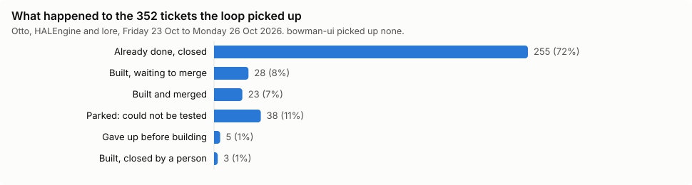
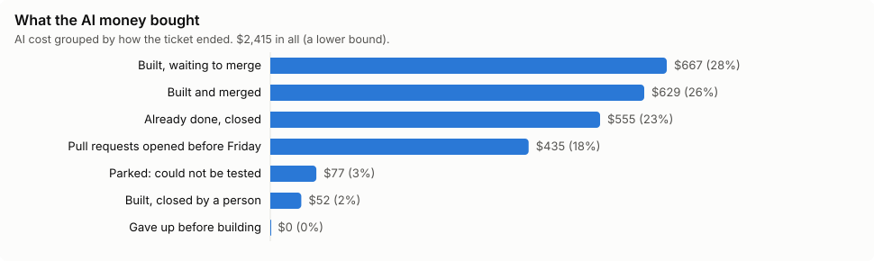
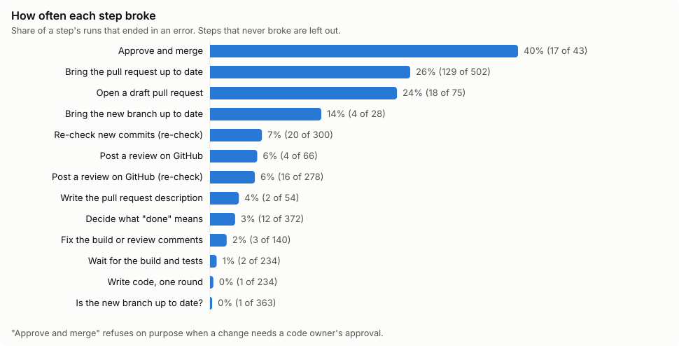
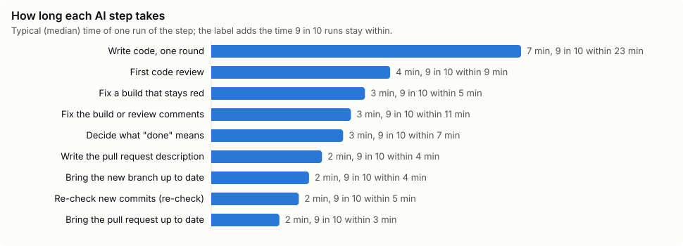
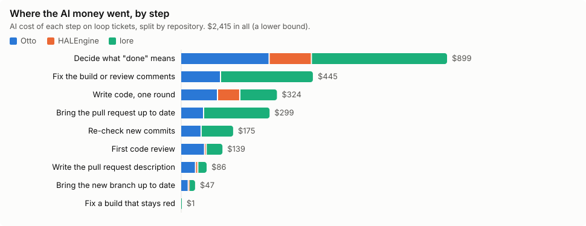
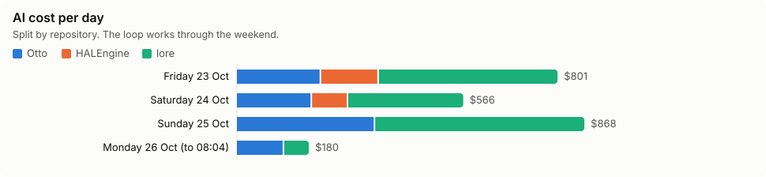
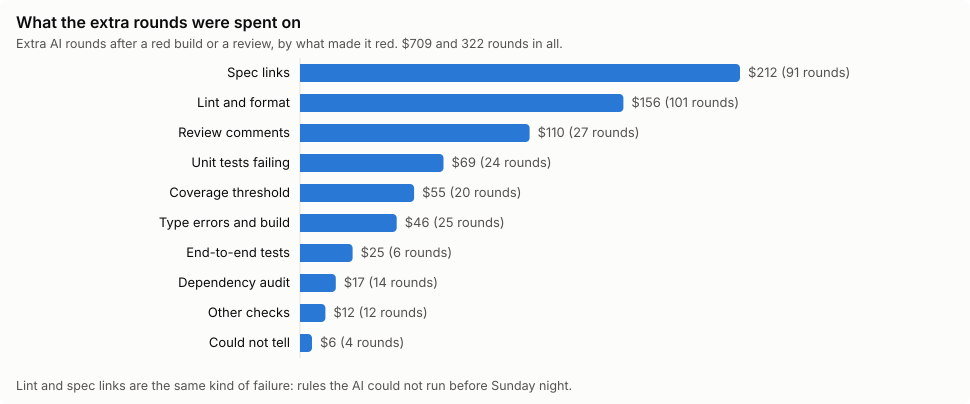
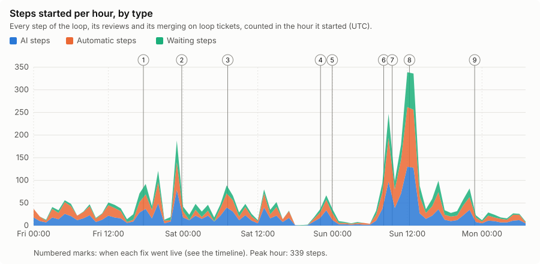

# The implementation loop over the weekend of 23 October 2026

**For anyone who wants to know what Lore's coding robot did, what it cost, where it got stuck and what it took to unstick it.** No engineering background needed: every term is explained where it first appears, and there is a glossary at the end.

The period is **Friday 23 October 00:00 to Monday 26 October 08:04 (UTC)**, on four repositories: **Otto**, **HALEngine**, **bowman-ui** and **lore**.

## What the loop is

Lore's *implementation loop* is a robot that turns tickets into code. A ticket is a GitHub issue with a priority label. The loop takes one ticket at a time per repository and walks it through a fixed series of **steps**:

1. Make sure it starts from the latest code.
2. **Decide what "done" means**: an AI reads the ticket and writes tests that fail today and will pass once the ticket is finished. Or it stops there, because the work is already done, or because the ticket cannot be written as tests.
3. Open a draft **pull request** (the proposed change, waiting to be accepted).
4. **Write code, one round at a time**, until the build and tests (*CI*) are green.
5. Write the pull request's description and mark it ready.
6. **Get it reviewed** by Lore's AI reviewer, fix what the reviewer or the build asks for, and keep the pull request up to date with everyone else's changes.
7. **Merge it**, once it is reviewed, green and at least 24 hours old.

Some steps are done by an **AI** (they cost money), some are **automatic** checks (free, a few seconds), and some are **waiting** steps (free, they wait for the build, a review or a merge).

## In one page

- The loop picked up **352 tickets**. Most needed no code: it found **255 already done** and closed them, and **parked 38** it could not turn into tests. It built **54** into a pull request: **23 merged**, 28 are waiting to merge, 3 were closed by a person. 5 gave up before building. bowman-ui picked up nothing: its loop is switched off.
- The AI cost **at least $2,415**, probably about **$3,300** (see [How sure are the costs?](#how-sure-are-the-costs)). A merged ticket typically cost **$21**, between $6 and $63.
- A ticket typically had its pull request **about 6 minutes** after the loop picked it up, and was merged **about a day and a half** later. Most of that wait is the 24-hour minimum age and the review.
- The single most expensive step is the first one: **deciding what "done" means, $899 (37%)**, because it runs on every ticket, including the 293 that end right there.
- **The loop got stuck on Saturday.** Otto's ten open pull requests all waited on things nobody was doing: Lore's own review asking for changes that no step made, rebases that kept failing, and a webhook that never told the loop a build had finished. It took **14 fixes to Lore** (about 3,600 lines added) and a series of manual steps over the weekend. After the fix of Sunday 12:21 went live, all ten merged within 3.5 hours. See [What it took to get the tickets through](#what-it-took-to-get-the-tickets-through).
- **Lint was the biggest avoidable cost.** Of $709 spent on extra rounds after a red build, $368 went on lint and spec-link rules the AI was not allowed to run before pushing. Letting it run them would have saved about **170 rounds and $300**, and 5 runs that gave up would probably have finished. It may since Sunday night (#3461). See [What the extra rounds cost](#what-the-extra-rounds-cost).
- **Old pull requests kept failing.** Seven lore pull requests from before Friday took 97 runs, 80 of them failures, and $366, and none merged. Monday's fix (#3462) targets exactly this.

## The tickets

| Repository | Tickets picked up | Built and merged | Built, waiting to merge | Built, closed by a person | Already done, closed | Parked: could not be tested | Gave up before building | AI cost |
|---|---|---|---|---|---|---|---|---|
| Otto | 100 | 11 | 14 | 3 | 56 | 13 | 3 | $797.59 |
| HALEngine | 64 | 0 | 6 | 0 | 56 | 1 | 1 | $234.62 |
| bowman-ui | 0 | 0 | 0 | 0 | 0 | 0 | 0 | $0.00 |
| lore | 188 | 12 | 8 | 0 | 143 | 24 | 1 | $948.37 |
| **All four** | 352 | 23 | 28 | 3 | 255 | 38 | 5 | $1,980.58 |

What each column means:

- **Built and merged / waiting to merge / closed by a person**: the loop wrote the code and opened a pull request, which is now in that state.
- **Already done, closed**: the AI found the work already in the code, closed the ticket and said which change did it.
- **Parked: could not be tested**: the AI could not express the ticket as tests (for example, it is a decision or a manual step). The ticket gets a `lore:blocked` label and a comment saying what is missing.
- **Gave up before building**: every attempt failed before a pull request existed.
- **AI cost**: every AI step on the ticket, its reviews included.

### Cost and time by what happened

"Typical" is the middle value (half are below, half above); "9 in 10 under" is the value nine tickets in ten stay below.

| What happened | Tickets | AI cost | Typical ticket | 9 in 10 under | Cheapest – dearest | Start to pull request, typical | range | Pull request to merged, typical | range |
|---|---|---|---|---|---|---|---|---|---|
| Built and merged | 23 | $629.04 | $21.02 | $48.20 | $6.31 – $62.71 | 6 min | 3 min – 1.7 h | 1.5 days | 12.1 h – 2.4 days |
| Built, waiting to merge | 28 | $666.86 | $13.32 | $47.22 | $2.93 – $114.33 | 5 min | 2 min – 29 min | – | – |
| Built, closed by a person | 3 | $52.13 | $17.59 | $18.86 | $15.68 – $18.86 | 5 min | 4 min – 8 min | – | – |
| Already done, closed | 255 | $554.66 | $1.85 | $3.84 | $0.47 – $7.40 | – | – | – | – |
| Parked: could not be tested | 38 | $77.39 | $1.60 | $4.04 | $0.22 – $7.10 | – | – | – | – |
| Gave up before building | 5 | $0.50 | $0.10 | $0.20 | $0.00 – $0.20 | – | – | – | – |

### Pull requests from before Friday

The loop also kept working on pull requests opened before the period: 13 pull requests, 110 loop runs, 83 of which gave up, $434.59. The seven lore ones are still open and have no prospect of merging as things stand; each time someone merges anything, they fall behind again and the loop tries once more to bring them up to date.

| Repository | Pull request | Now | Loop runs since Friday | Of which gave up | AI cost |
|---|---|---|---|---|---|
| Otto | #245 | closed | 2 | 0 | $27.69 |
| Otto | #439 | merged | 0 | 0 | $18.89 |
| Otto | #437 | merged | 5 | 1 | $9.54 |
| Otto | #248 | merged | 2 | 2 | $6.91 |
| Otto | #386 | merged | 0 | 0 | $1.89 |
| lore | #3057 | open | 6 | 1 | $90.11 |
| lore | #2879 | open | 25 | 24 | $76.17 |
| lore | #2881 | open | 14 | 13 | $56.65 |
| lore | #2880 | open | 27 | 20 | $52.50 |
| lore | #2878 | open | 7 | 7 | $38.61 |
| lore | #2876 | open | 11 | 9 | $30.51 |
| lore | #2877 | open | 7 | 6 | $21.47 |
| lore | #3056 | merged | 4 | 0 | $3.64 |

## The steps

Each table lists the steps in the order a ticket meets them. **Times run** counts every time the step ran: a step runs several times on one ticket when a round is repeated. **What it decided** is how the step sent the ticket on. **Broke** is the share of times it ended in an error.

### Building a ticket

| # | Step | Who | Times run | What it decided | Broke | Typical time | 9 in 10 within | Fastest – slowest | AI cost | Typical cost a time | Dearest single time | AI model |
|---|---|---|---|---|---|---|---|---|---|---|---|---|
| 1 | Is the new branch up to date?  `sync-start` | automatic | 363 | 93% up to date; 7% behind, sent to be updated | 0% | 2 s | 3 s | 1 s – 39 s | – | – | – | – |
| 1a | Bring the new branch up to date  `sync-start-rebase` | AI | 28 | 86% updated | 14% | 2 min | 4 min | 1 min – 6 min | $46.75 | $1.36 | $6.08 | Gemini 3.1 Pro |
| 2 | Decide what "done" means  `dod` | AI | 372 | 18% build it; 79% stop: already done, or cannot be tested | 3% | 3 min | 7 min | 22 s – 1.5 h | $898.86 | $1.89 | $12.45 | Gemini 3.1 Pro |
| 3 | Open a draft pull request  `open-pr` | automatic | 75 | 76% opened | 24% | 5 s | 7 s | 2 s – 14 s | – | – | – | – |
| 4 | Write code, one round  `tdd-round` | AI | 234 | 100% round pushed | 0% | 7 min | 23 min | 1 min – 1.1 h | $323.57 | $0.91 | $7.64 | Claude Sonnet 4.6 |
| 5 | Wait for the build and tests  `await-ci` | waiting | 235 | 23% green; 76% red, another round; 0% still waiting | 1% | 5 min | 17 min | 46 s – 1.5 h | – | – | – | – |
| 5a | Fix a build that stays red  `repair-build` | AI | 2 | 50% fixed; 50% not fixed | 0% | 3 min | 5 min | 2 min – 5 min | $1.40 | $0.70 | $0.79 | Gemini 3.1 Pro |
| 6 | Write the pull request description  `ready-for-review` | AI | 54 | 96% written | 4% | 2 min | 4 min | 1 min – 6 min | $85.83 | $1.54 | $3.39 | Gemini 3.1 Pro |
| 7 | Up to date before review?  `sync-final` | automatic | 52 | 100% up to date | 0% | 2 s | 4 s | 1 s – 1 min | – | – | – | – |
| 8 | Mark ready for review  `mark-ready` | automatic | 52 | 100% marked | 0% | 5 s | 7 s | 4 s – 5 min | – | – | – | – |
| 9 | Wait until the pull request can merge  `await-pr` | waiting | 562 | 31% mergeable; 68% not yet, sent to be fixed; 1% still waiting | 0% | 9 min | 54 min | 6 s – 7.1 h | – | – | – | – |
| 9a | Is the pull request up to date?  `sync-pr` | automatic | 603 | 25% up to date; 75% behind or red, sent to be fixed | 0% | 5 s | 20 s | 1 s – 59 s | – | – | – | – |
| 9b | Bring the pull request up to date  `sync-pr-rebase` | AI | 502 | 74% updated | 26% | 2 min | 3 min | 38 s – 6 min | $298.66 | $0.46 | $5.64 | Gemini 3.1 Pro |
| 9c | Fix the build or the review's comments  `fix-ci` | AI | 140 | 98% fixed | 2% | 3 min | 11 min | 33 s – 1.3 h | $445.26 | $2.21 | $31.15 | Gemini 3.1 Pro |

Reading it:

- **Deciding what "done" means is the most expensive step and mostly says "no build needed"**: 79% of the time it ends the ticket there (already done, or cannot be tested). When it says "build it" but writes no tests, the next step, opening the pull request, breaks with "the step before pushed nothing". That is all 18 of that step's breaks, on 8 tickets.
- **Writing code** typically takes 7 minutes a round and almost never breaks.
- **Waiting for the build** says "red, another round" three times out of four: CI is the judge of every round.
- **Bringing a pull request up to date** breaks 26% of the time, mostly on the old lore pull requests.

### Reviewing a pull request

The first review reads the whole change; a re-check reads only what was pushed since, and runs every time new commits arrive.

| # | Step | Who | Times run | What it decided | Broke | Typical time | 9 in 10 within | Fastest – slowest | AI cost | Typical cost a time | Dearest single time | AI model |
|---|---|---|---|---|---|---|---|---|---|---|---|---|
| R1 | Review the code (first review)  `review` | AI | 66 | 45% approved; 55% asked for changes | 0% | 4 min | 9 min | 1 min – 21 min | $139.39 | $1.78 | $9.18 | Gemini 4 Argon |
| R2 | Post the review on GitHub  `post-review` | automatic | 66 | 94% posted | 6% | 11 s | 13 s | 0 s – 19 s | – | – | – | – |

| # | Step | Who | Times run | What it decided | Broke | Typical time | 9 in 10 within | Fastest – slowest | AI cost | Typical cost a time | Dearest single time | AI model |
|---|---|---|---|---|---|---|---|---|---|---|---|---|
| R3 | Re-check new commits  `recheck` | AI | 300 | 46% approved; 47% asked for changes | 7% | 2 min | 5 min | 47 s – 50 min | $175.45 | $0.38 | $5.95 | Gemini 4 Argon |
| R4 | Post the re-check on GitHub  `post-review` | automatic | 278 | 94% posted | 6% | 13 s | 42 s | 1 s – 1.0 h | – | – | – | – |

### Merging

| # | Step | Who | Times run | What it decided | Broke | Typical time | 9 in 10 within | Fastest – slowest | AI cost | Typical cost a time | Dearest single time | AI model |
|---|---|---|---|---|---|---|---|---|---|---|---|---|
| M1 | Wait until it is safe to merge  `await-merge` | waiting | 59 | 73% safe; 27% still waiting | 0% | 5.6 h | 1.9 days | 2 min – 2.1 days | – | – | – | – |
| M2 | Approve and merge  `approve` | automatic | 43 | 60% merged or merge armed | 40% | 8 s | 12 s | 2 s – 16 s | – | – | – | – |

"Approve and merge" breaks 40% of the time, but on purpose: every one of the 17 is a lore pull request that touches files only a named owner may approve (`CLAUDE.md`, an ADR). It asks again on every new attempt.

## Where the money went

AI cost of each step per repository, with how many times it ran:

| # | AI step | Otto | HALEngine | bowman-ui | lore |
|---|---|---|---|---|---|
| 1a | Bring the new branch up to date | $25.73 (14×) | $3.00 (3×) | – | $18.01 (11×) |
| 2 | Decide what "done" means | $299.23 (108×) | $142.90 (67×) | – | $456.73 (197×) |
| 4 | Write code, one round | $124.71 (127×) | $75.43 (37×) | – | $123.43 (70×) |
| 5a | Fix a build that stays red | – | – | – | $1.40 (2×) |
| 6 | Write the pull request description | $50.35 (29×) | $7.72 (4×) | – | $27.76 (21×) |
| 9b | Bring the pull request up to date | $77.54 (88×) | – | – | $221.12 (414×) |
| 9c | Fix the build or the review's comments | $134.91 (63×) | – | – | $310.35 (77×) |
| R1 | Review the code (first review) | $80.88 (36×) | $5.58 (4×) | – | $52.93 (26×) |
| R3 | Re-check new commits | $69.17 (142×) | – | – | $106.29 (158×) |

### The four processes, as a whole

A **run** is one trip of a ticket through a process, from its first step until it finishes or gives up.

| Process | Runs | How runs ended | Typical run | 9 in 10 within | Fastest – slowest | AI cost | Typical run cost | Dearest run |
|---|---|---|---|---|---|---|---|---|
| Merging | 59 | 73% finished; 22% still running; 5% cancelled | 3.3 h | 1.9 days | 2 min – 2.1 days | $0.00 | $0.00 | $0.00 |
| First code review | 63 | 98% finished; 2% gave up | 4 min | 9 min | 2 min – 21 min | $139.39 | $1.87 | $9.18 |
| Re-check after new commits | 288 | 91% finished; 9% cancelled; 1% gave up | 2 min | 4 min | 1 s – 12 min | $175.45 | $0.39 | $5.95 |
| Building a ticket (the loop) | 585 | 79% finished; 20% gave up; 1% cancelled; 0% still running | 4 min | 2.0 h | 34 s – 1.2 days | $2,100.33 | $1.72 | $73.03 |

"Gave up" means a step failed more times than it is allowed to retry (its *retry budget*). The places it happened most:

| Gave up at | Runs | Why |
|---|---|---|
| Bring the pull request up to date | 64 | the update failed more often than allowed; mostly the old lore pull requests |
| Is the pull request up to date? | 29 | it kept falling behind, or kept being sent back to be fixed, until the budget ran out |
| Open a draft pull request | 9 | "done" was defined but no tests were written |
| Wait until the pull request can merge | 8 | it stayed unmergeable six checks in a row |
| Wait for the build and tests | 3 | twelve rounds without a green build (HALEngine #41, #68, lore #3382) |
| Bring the new branch up to date | 2 | could not update the fresh branch (Otto #158) |
| Write the pull request description | 1 | |
| Pull request closed | 3 | a person closed it (Otto #471, #472, #477) |

## What the extra rounds cost

Every time CI comes back red, or a review asks for changes, the loop sends the AI back for another round. To price those rounds, every version the AI pushed to a loop pull request was matched with the CI checks that judged it. Each failed check was read from its log to tell why it failed: a lint rule, a spec link, a type error, a failing test, test coverage under the threshold, a dependency advisory. The next AI round was then charged to that cause.

**428 of the 802 versions the AI pushed came back red.** The loop spent **322 extra rounds, $709 in AI, 46 hours of AI time and 91 hours waiting for CI** answering them.

| What made it red | Red builds | Extra rounds | AI cost | AI hours | Hours waiting for CI | Runs that gave up |
|---|---|---|---|---|---|---|
| Spec links: a test not linked to the spec line it proves, or linked to the wrong line | 197 | 91 | $212 | 13.3 | 38.5 | 2.3 |
| Lint and format: code-style rules | 210 | 101 | $156 | 11.0 | 22.0 | 3.3 |
| Review comments (CI was green) | – | 27 | $110 | 4.0 | 11.8 | 0 |
| Unit tests failing | 42 | 24 | $69 | 5.0 | 6.0 | 0.5 |
| Coverage under the threshold | 23 | 20 | $55 | 4.5 | 1.5 | 4 |
| Type errors and build | 53 | 25 | $46 | 2.9 | 4.0 | 1.3 |
| End-to-end tests | 21 | 6 | $25 | 1.0 | 1.7 | 0.3 |
| Dependency audit (a security advisory on a library) | 44 | 14 | $17 | 2.0 | 1.2 | 0 |
| Other checks | 16 | 12 | $12 | 2.2 | 3.0 | 1.5 |
| Could not tell | – | 4 | $6 | 0.6 | 1.5 | 1 |
| **All** | **428 of 802** | **322** | **$709** | **46** | **91** | **14** |

A build that failed for two reasons has its rounds split between them, which is why some counts are fractions.

### Lint

Lint and spec links are the same kind of failure: rules CI checks that the AI was not allowed to run itself until Sunday night, because the linter was too heavy for the pods' memory then. So it only learned a rule was broken after a full CI cycle, which takes about 32 minutes on lore and 5 on Otto. Lore's lint job also runs before the tests, so a lint failure hid any other failure for one more cycle. The worst cases: lore #2879 had lint red 21 times in a row, and spec links were red 16 times on lore #2881 and 12 times on #3430.

If the AI could have run the same rules before pushing:

| What it runs before pushing | Rounds saved | AI cost saved | AI hours saved | Hours of CI waiting saved | Runs that would not have given up |
|---|---|---|---|---|---|
| Lint and format only | 65 | $64 | 4.2 | 10.2 | 0 |
| Lint, format and the spec-link rules | **170** | **$302** | **20** | **55** | **5** (HALEngine #290, lore #3389, #3430, #2877, #2878) |

A round counts as saved only when everything that made it red is something the AI could have seen locally, so these are lower bounds. They assume the AI fixes what it sees in the same round.

Since #3461 (Sunday 22:49) the AI lints what it changes. The 9 hours after it are too few, and mostly overnight, to show the effect yet: rounds touched by lint fell from 2.9 an hour to 1.1.

### The other avoidable causes

- **The fixing AI could not see why the build was red.** The CI summary it reads kept only the first 2,500 characters of a failed step. In all 20 of Otto's coverage failures, and 19 of its 23 failing-test builds, the reason came after that cut. All four Otto runs that ended red on coverage (#499, #500, #501, #502) spent their three fix attempts blind. That cost 20 rounds and $55. #3460 now keeps the end of the output, where the failure is.
- **Type errors**: 25 rounds and $46, of which 19 rounds and $20 would have been avoided if the AI ran the type check before pushing.
- **A dependency advisory** (body-parser and undici) turned 44 builds red on Otto and HALEngine. It came from main, not from the tickets, and mostly sat on top of real failures: only 3 rounds failed on it alone.
- **Answering review comments** is the most expensive kind of round, about $4.10 each.
- No check was flaky: nothing that failed passed again when re-run on the same version.

## When the work happened

The numbered marks are the fixes in the timeline below. Saturday evening is almost flat: Otto's loop had nothing left to pick, because every ticket it could start already had a stuck pull request. The Sunday peak, up to 339 steps an hour, is the loop catching up once the fixes were live.

## What it took to get the tickets through

The loop did not get here on its own. Over the weekend Bogdan merged **14 fixes to Lore** (+3,581 / −1,634 lines) and did the manual steps around them. The numbers match the marks on the chart above.

### Why the tickets got stuck

In plain words, five things held them:

1. **Lore's own review asked for changes, and nothing made them.** GitHub does not let the account that opened a pull request "request changes" on it, so Lore's verdict only appeared as a grey check. The step that answers review comments never started, the loop handed the pull request "to people", and the merge step skipped it. On Saturday 8 of Otto's 10 open pull requests sat there, and since every ticket Otto could start already had one, the loop stopped picking anything.
2. **Updating a pull request kept failing.** Otto's main code briefly carried a scratch file the loop uses (`.lore/dod.md`); every branch cut in that window hit a conflict on it, and the AI was told to give up on such conflicts. Its rebases also replayed every small round one by one, colliding again and again.
3. **The loop never heard that a build had finished.** It listens for GitHub's "build finished" event, but no repository's webhook was set up to send it. A pull request that went red after its run ended was never repaired.
4. **Busy repositories starved the queue.** Each change to main restarted updates for at most three pull requests, always the same three oldest, which kept failing, so the others never got a turn.
5. **The AI fixed blind.** The build summary it reads kept only the first part of a failing step's output, so in a big repository it saw three passing packages and never the failing one. And lint errors it could not see locally cost whole rounds (HALEngine #68 spent twelve rounds on one lint rule).

### Timeline

| # | When (UTC) | What changed | Why |
|---|---|---|---|
| | Fri 07:00–08:04 | Bogdan finished and merged three older Otto loop pull requests by hand (#386, #438, #439): merged main in, added missing test coverage, fixed spec links, removed test-only code | they were close but would not get over the line on their own |
| 1 | Fri 17:38 | [#3376](https://github.com/re-cinq/lore/pull/3376): the loop keeps its pull requests mergeable after its run ends; the merge step stops fixing code | nothing looked after a loop pull request once its run had finished |
| 2 | Fri 23:47 | [#3390](https://github.com/re-cinq/lore/pull/3390): at most 3 update runs per change to main | the first push after #3376 started six updates at once |
| 3 | Sat 07:10 | [#3395](https://github.com/re-cinq/lore/pull/3395): review lookups read each review process separately | in a busy repository a pull request's review fell out of the window read, so it waited at "safe to merge" forever |
| 4 | Sat 22:04 – Sun 00:02 | [#3432](https://github.com/re-cinq/lore/pull/3432), [#3433](https://github.com/re-cinq/lore/pull/3433), [#3434](https://github.com/re-cinq/lore/pull/3434), [#3438](https://github.com/re-cinq/lore/pull/3438): the loop makes the changes Lore's own review asks for; a re-check is handed the open findings, and only its approval closes them | cause 1 above; #3433 took back a first attempt that could have let unfixed findings merge |
| 5 | Sun 00:00 | [#3437](https://github.com/re-cinq/lore/pull/3437): a conflict on the loop's scratch file no longer aborts the update | cause 2 above |
| | Sat 23:40 – Sun 01:00 | Restarted Otto's 8 stuck pull requests one at a time (the system allows only one at a time this way) | their runs had already ended; the first end-to-end success was Otto #502 at 23:56 |
| | Sun 08:00–09:00 | Bogdan updated Otto #499, #500, #501 by hand, removed the scratch file from #437 and fixed its code, and removed `lore:blocked` labels | the automatic updates still failed on them |
| 6 | Sun 08:13 | [#3439](https://github.com/re-cinq/lore/pull/3439) and [#3440](https://github.com/re-cinq/lore/pull/3440): the loop hears "build finished", and takes turns across pull requests; the runs list survives slow cost reads | causes 3 and 4 above |
| | Sun 08:59 → 09:24 | The loop closed Otto #326 as "already done" while its finished pull request #501 was still open; Bogdan reopened it | a picked-up ticket with a finished pull request restarted from the beginning |
| 7 | Sun 09:35 | [#3446](https://github.com/re-cinq/lore/pull/3446): such a ticket continues at "keep the pull request up to date" instead | so it cannot be closed by mistake again |
| | Sun 11:30 | Bogdan widened the webhooks of lore and Otto so GitHub sends "build finished" | needed once per repository; HALEngine and the others still lack it |
| 8 | Sun 12:21 | [#3450](https://github.com/re-cinq/lore/pull/3450): updates rebuild the branch as one commit and keep both sides' work; 8 fix rounds instead of 3 | cause 2 above; then each stuck pull request was kicked by re-running one of its checks. **All ten Otto pull requests (#499–#508) merged by 15:54** |
| 9 | Sun 22:48–22:49 | [#3460](https://github.com/re-cinq/lore/pull/3460), [#3461](https://github.com/re-cinq/lore/pull/3461): the AI sees the end of a failing build log, and the AI steps that write code lint their own changes | cause 5 above; see [What the extra rounds cost](#what-the-extra-rounds-cost) |
| | Mon 08:18 | Bogdan added a starting test by hand on lore #2879 | to get it past its first round |
| | Mon 08:28 | [#3462](https://github.com/re-cinq/lore/pull/3462): update a pull request only when GitHub says it must | #2876 was updated six times in one run and #2879/#2880 had about 25 runs each: main moved faster than CI, so they never caught up (about 30 of the 96 gave-up runs) |

Fixes 9 and #3462 went live at the very end of the period, so their effect is not in these numbers yet.

## How sure are the costs?

Every cost here adds up what each AI step reported for its own model calls. The system also prices whole runs, but that read timed out for about half of them. For the 481 runs it did price, its total is **$1,358**, while their steps add up to **$1,000**: about 36% more than the steps show. The cause is not known; one likely reason is an AI step that was retried inside a run, where only the last attempt is listed. So treat every cost as **at least** that much. At the same ratio, the period's $2,415 would be about **$3,280**.

## Open questions

- **Does the AI close tickets correctly?** A sample of eight "already done" closures were right, each naming the change that did the work. One looked wrong: Otto #563 ("Compliance and Data Flow Document Updates") was closed citing a change to the README and an auth helper. Checking a bigger sample against the tickets would tell how often that happens.
- **Should the 38 parked tickets be rewritten?** Otto 13, HALEngine 1, lore 24. Each has the AI's reason; most are decisions or manual steps rather than code.
- **Why does the AI sometimes say "build it" but write nothing?** The 8 tickets behind "open a draft pull request" breaking each got an unusually short "done" step (about $0.10 instead of about $1.89).
- **Should the loop give up on old pull requests?** The seven lore ones cost $366 in four days without moving. #3462 should help; if it does not, they need a person or a close.
- **HALEngine still lacks the "build finished" webhook**, so its pull requests are not repaired after their run ends; its 6 open pull requests have not merged.
- **The system's job server is unhealthy.** Both copies of floor-api fail their health check (249 times in six days), so reads of runs fail now and then; collecting this data hit it.

## Glossary

| Term | Meaning |
|---|---|
| Ticket | A GitHub issue the loop may work on: it has a `priority:*` label. |
| Pull request (PR) | A proposed change to a repository's code, reviewed before it is merged. |
| Merge | Accepting a pull request into the main code. |
| CI / the build | The automatic build and tests GitHub runs on every change. Green = passing, red = failing. |
| Step (station) | One stage of a process. `dod`, `tdd-round` and so on are the internal names under each step. |
| Run | One trip of a ticket or pull request through a process, start to finish. |
| AI step | A step done by an AI model (Gemini 3.1 Pro, Gemini 4 Argon or Claude Sonnet 4.6); the only steps that cost money. |
| Retry budget / gave up | How many times a step may be retried in one run; past it, the run gives up (`iteration_max`). |
| Rebase / bring up to date | Moving a pull request on top of the latest main code so it does not conflict. |
| Re-check | A short review of only the commits pushed since the last review. |
| Upkeep run | A run the loop starts on its own to keep an open pull request up to date and green. |
| Parked (`lore:blocked`) | A ticket the loop will not pick again until a person rewrites it and removes the label. |
| Typical / 9 in 10 | The median, and the 90th percentile. |

## How the numbers were made

Collected on Monday 26 October 2026 from Lore's API (`/api/floor-runs`, each run's steps at `/api/assembly-runs/{id}`, and each AI step's model calls at `/api/assembly-runs/{id}/visits/{visitId}/model-calls`) and from GitHub (the loop's pull requests and the tickets' states). Only runs on the loop's own branches (`lore/implementation-loop/*`) are counted: reviews of people's pull requests, digests and spec upkeep are not. Reading the 995 runs took about an hour, at about 13 seconds a read. The collection scripts and the raw data are not in this repository, because the raw data holds private repositories' content.
