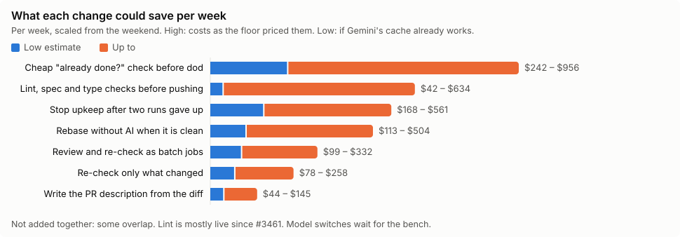
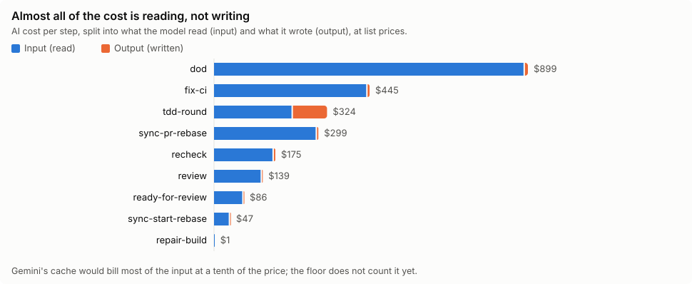
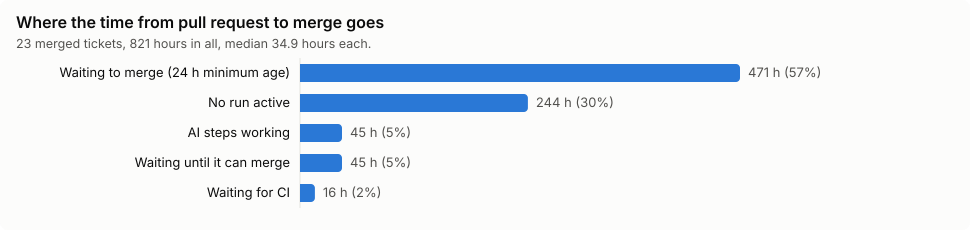

# Making the implementation loop cheaper and faster

**For anyone deciding what to change in Lore's coding robot to spend less and merge sooner.** It builds on [the weekend report](implementation-loop-2026-10-23-weekend.md), which describes what the loop did from Friday 23 to Monday 26 October 2026 on Otto, HALEngine and lore. This page asks where that money and time could be saved, and how. The work is tracked in the story [#3494](https://github.com/re-cinq/lore/issues/3494), with one task issue per change. The live numbers are on the Grafana board [Lore · Implementation loop](https://grafana.gcp.re-cinq.com/d/lore-implementation-loop).

## In one page

- **First, find out what Gemini really costs us.** Every Gemini step is counted at the full input price, $2,066 of the weekend's $2,415. Gemini caches repeated input by itself and bills it at a tenth of the price, and our pods qualify, but the floor's price settings ignore the cache. So either our reports overstate the Gemini bill about three times, or the pods miss the cache and we pay that much more than we should. Every other estimate here depends on which ([#3495](https://github.com/re-cinq/lore/issues/3495)).
- **Almost all of the cost is the models reading, not writing.** Each AI step reads between 0.3 and 2.3 million tokens and writes a few thousand. Cutting what a step reads, or how often a step runs, is what saves money.
- **The biggest savings** are a cheap "is this ticket already done?" check before the most expensive step ($240 to $960 a week), stopping upkeep runs on pull requests that keep failing ($170 to $560), rebasing without AI when nothing conflicts ($110 to $500), and re-reviewing only what changed ($80 to $260).
- **Time to merge is mostly waiting.** Of the 821 hours between opening and merging the weekend's 23 merged pull requests, 57% was the merge wait, mostly the 24 hour minimum age. The AI worked for 5% of it.
- **Batch jobs** from ai-agent-subsystem halve the price of a model call but take up to a day and allow no tools, so only the reviews fit ($100 to $330 a week).
- **Cheaper models** look promising in loop-bench, but only on small tickets so far. No switch is proposed until the bench covers the larger ones.

## How to read the estimates

Each saving is the weekend's cost of the thing a change removes, scaled to a week (× 2.1). Each has a range:

- **High:** the cost as the floor priced it.
- **Low:** the same, if Gemini's cache already works and Gemini input really costs a third or less of what we count.

The savings overlap, so they are not added together. A ticket closed early by the "already done" check, for example, also never needs a rebase.

## Where the money goes

| Step | Times run | AI cost | Model | Input per run, average | Input / output tokens |
|---|---|---|---|---|---|
| Decide what "done" means (`dod`) | 372 | $899 | Gemini 3.1 Pro | 1.2 M | 446 M / 0.7 M |
| Fix the build or review comments (`fix-ci`) | 140 | $445 | Gemini 3.1 Pro | 1.6 M | 221 M / 0.5 M |
| Write code, one round (`tdd-round`) | 234 | $324 | Claude Sonnet 4.6 | 2.3 M | 544 M / 6.5 M |
| Bring the pull request up to date (`sync-pr-rebase`) | 502 | $299 | Gemini 3.1 Pro | 0.29 M | 148 M / 0.3 M |
| Re-check new commits (`recheck`) | 300 | $175 | Gemini 4 Argon | 0.29 M | 86 M / 0.4 M |
| First review (`review`) | 66 | $139 | Gemini 4 Argon | 1.0 M | 69 M / 0.2 M |
| Write the pull request description (`ready-for-review`) | 54 | $86 | Gemini 3.1 Pro | 0.79 M | 42 M / 0.1 M |
| Bring the new branch up to date (`sync-start-rebase`) | 28 | $47 | Gemini 3.1 Pro | 0.83 M | 23 M / 0.05 M |

Claude Sonnet's input already costs $0.42 per million on average against a $3 list price, because Anthropic's cache works and the floor counts it. Gemini's does not show at all.

## The changes, in the order to make them

### 1. Count Gemini's cache, and keep it hitting ([#3495](https://github.com/re-cinq/lore/issues/3495))

Gemini caches by itself. Implicit caching is on by default for Gemini 3.1 Pro and 3 Flash, and bills a repeated prefix of 2,048 tokens or more at 10% of the input price, with no storage fee. gemini-cli supports it with the API key our pods use. In loop-bench, gemini-cli reads 77 to 90% of its input from the cache.

The floor records Gemini's cached tokens but prices them at the full input price, because our price settings name no cache price. The fix for the numbers is one line per price block. The fix for the bill, if the pods turn out to miss the cache, is to keep each prompt's fixed part first and the ticket last, so consecutive requests share a long prefix. Then compare a week of the floor's numbers with Google's bill.

If the cache already works the way it does in the bench, the weekend's real Gemini bill was roughly a third of what we counted, and every Gemini saving below shrinks to the low end of its range.

### 2. Stop upkeep on pull requests that keep failing ([#3496](https://github.com/re-cinq/lore/issues/3496))

Runs after a ticket's first cost $693, 29% of the weekend's spend. The worst of it: after two upkeep runs on the same pull request gave up in a row, the loop started 77 more on those pull requests. They cost $267, and 11 of them succeeded. lore #2879 had 25 runs and #2880 had 27, and neither merged. After two runs give up, the ticket should be parked for a person with the reason.

### 3. Check "already done?" before the most expensive step ([#3497](https://github.com/re-cinq/lore/issues/3497))

The definition-of-done step runs on every ticket and costs $2.07 even when it ends the run straight away, which it did 294 times out of 372 ($607). It only reaches "already done" after reading the spec and starting on the tests. A service step that looks for merged changes naming the issue, and a small model judging the ticket against them, would answer most of those for a fraction of the cost. Closures must keep their reason. One of the weekend's looked wrong (Otto #563), so the check is measured on 50 past closures first.

### 4. Rebase without AI when nothing conflicts ([#3498](https://github.com/re-cinq/lore/issues/3498))

Every rebase starts a Gemini pod that reads at least 150,000 tokens (227,000 at the median), even when the rebase is clean: 502 rebases, $299. Trying a plain rebase first and calling the AI only on a conflict removes most of that. The estimate assumes 60 to 80% of rebases are clean. The data does not record conflicts, so this share is a guess the task should measure.

### 5. Re-check only what changed ([#3499](https://github.com/re-cinq/lore/issues/3499))

There were 300 re-checks for 66 first reviews. 170 of them ($123) came right after a push that was only a rebase, and 149 of those gave the same verdict as before. Since a rebase now rebuilds the branch as one commit, the re-check cannot tell what is new and reads the whole pull request again. When the pull request's own change is the same as the one Lore already approved, the approval should carry over. Merging needs Lore's approval on the latest commit, so this also stops every rebase from restarting the wait.

### 6. Let the code-writing step check its work before pushing ([#3500](https://github.com/re-cinq/lore/issues/3500))

Extra rounds after a red build cost $709. Lint and spec-link rules took $368 of it and type errors $46 ([details](implementation-loop-2026-10-23-weekend.md#what-the-extra-rounds-cost)). Since #3461 (Sunday night) the agents lint what they change, which should already remove most of the lint rounds. So this estimate is the least certain, and the first step is to measure it again. The rest is structural. The code-writing step writes one slice per pod and is not allowed to run the acceptance tests, so CI stays red until the last slice: about four CI round trips per built ticket, 32 minutes each on lore. Letting the step run the tests, the type check and the spec-link rules, with enough pod memory to do it, saves rounds and time.

### 7. Cap turns and spend ([#3501](https://github.com/re-cinq/lore/issues/3501))

No agent has a turn limit, although the floor supports one. One definition-of-done visit ran for 1.5 hours and cost $12.45. One fix visit cost $31.15. A turn limit per agent and the per-run spend cap asked for in #2395 put a ceiling on the worst cases. This is a safety net, not a weekly saving.

### 8. Cheaper models, once the bench says so ([#3502](https://github.com/re-cinq/lore/issues/3502))

loop-bench replays merged tickets with many models. Read from its results (1,631 loops), it is not yet enough to switch any step:

| Step | Candidate | What the bench shows | What is missing |
|---|---|---|---|
| Decide what "done" means | Claude Haiku 5.5 | 30 loops, all green, $0.11 a visit | All on #93, the smallest ticket |
| Fix the build | Claude Haiku 5.5 | 100% green on #93, 67% on #94, $0.03 to $0.06 a visit | Never run on #37, #95 or #144, where production's model fell to 0%. The bench's repair is also smaller than production's fix step, which answers review comments too |
| Write code | GLM-5.3-flash | 80 to 100% green on four tickets, $0.05 to $0.14 a visit | Never run on the large #144, and not a provider production can use today |
| Write code | Claude Sonnet 4.6 (production) | Only as the baseline on #93 | Never compared with the others across tickets |

The task is to run the missing cells, which needs more machines and subscriptions than one laptop has, and to switch a step only where the candidate matches production's success rate on the medium and large tickets.

### 9. Write the pull request description from the diff ([#3503](https://github.com/re-cinq/lore/issues/3503))

Writing a description reads 786,000 tokens on average, with the whole repository, the skills and Lore's context tools loaded. The diff, the ticket and the definition of done as text, on a small model, should be enough.

### 10. Wait less between green and merged ([#3504](https://github.com/re-cinq/lore/issues/3504))

The minimum age of 24 hours is a setting per repository. Where nobody needs a day to look at a loop pull request, 4 to 6 hours would cut the median time to merge by about half. On lore, pull requests that touch files a named owner must approve also wait for that person. The approve step refused 17 times over the weekend. A ping to the owner when everything else is ready would shorten that wait.

### 11. Reviews as batch jobs ([#3505](https://github.com/re-cinq/lore/issues/3505))

ai-agent-subsystem v0.13 can run a recipe as a batch job: about half the price, with the answer taking up to 24 hours. A batch job is a single model call. It has no tools, no repository checkout and no Lore context, so the steps that edit code cannot use it. The two review steps can, once they take the diff as text and answer in a fixed format. They cost $315 over the weekend on Gemini 4 Argon, whose price doubles after 30 November, which would add about $660 a week. Batch would offset that.

It needs the floor's copy of the subsystem upgraded from v0.11.11, a setting passed through the floor, and reworked review prompts. A batch can take a day, so it uses a short timeout that falls back to a normal run, and it comes after the re-check change (5), which removes most re-checks anyway.

### 12. Unblock the repositories the loop cannot repair ([#3506](https://github.com/re-cinq/lore/issues/3506), [floor#55](https://github.com/re-cinq/floor/issues/55))

The loop repairs a pull request whose build turns red after its run ends, but only if GitHub tells it the build finished. Only lore and Otto send that event today, so HALEngine's six open loop pull requests are never repaired. Separately, the floor's API fails its health check about 40 times a day, which made Lore's reads of the floor fail while collecting these numbers.

## What we don't know yet

- **The real Gemini bill.** Until it is compared with Google's, every Gemini saving has a three-fold range (task 1).
- **How many rebases conflict.** Task 4 assumes most are clean.
- **Whether a cheap model closes tickets as well as the current step.** Task 3 measures it before switching on.
- **What #3461 already saved.** The weekend had only nine hours after it.

## How the numbers were made

From the same data as the weekend report: every floor run on the loop's branches from Friday 23 October 00:00 to Monday 26 October 08:04 UTC on Otto, HALEngine and lore (995 runs), each step's model calls, and GitHub's pull requests and CI checks. A week is the weekend × 2.1. The loop-bench figures are read from its `results.jsonl`. Gemini's caching rules are from Google's [context cache overview](https://cloud.google.com/vertex-ai/generative-ai/docs/context-cache/context-cache-overview) and gemini-cli's [token caching](https://geminicli.com/docs/cli/token-caching/) page. The scripts and raw data are not in this repository, because the raw data holds private repositories' content.

## Glossary

| Term | Meaning |
|---|---|
| Step | One stage of the loop, such as deciding what "done" means or writing a round of code. Each AI step runs in its own pod. |
| Input / output tokens | What a model reads and what it writes. Models charge for both, input usually far less per token, but the loop reads far more than it writes. |
| Cache | A model provider's discount for input it has seen recently: the repeated start of a request is billed at a fraction of the price. |
| Upkeep run | A run the loop starts on its own to keep an open pull request up to date and green. |
| Gave up | A run that used up a step's retries (`iteration_max`). |
| Re-check | A short review of what was pushed since Lore's last review. |
| Batch job | A model call sent to the provider's batch queue: about half the price, answered within a day. |
| Minimum age | How long a loop pull request must exist before it may merge, 24 hours by default. |
