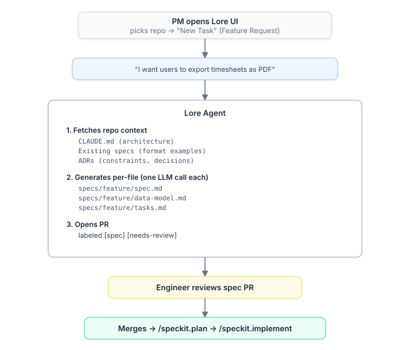

# Product Manager Guide

**For product managers turning ideas into shipped code.** You write what you want in plain language as a plan, together with Lore's planning agent and your team; approving it turns it into an engineering spec that follows the repo's conventions, and then into tickets. You never need to know speckit, MADR, or any technical format.

This guide walks the whole journey — from your one-paragraph idea to a merged pull request — so you can see exactly where your part begins and ends.

---

## From intent to a spec

A PM writes down a feature as a plan: a shared document in the repo's Lore UI that people and Lore's planning agent write together. Approving the plan turns it into engineering specs that match the patterns already in that codebase, and then into tickets an engineer or Lore's implementation loop picks up.

<p align="center"></p>

## The feature lifecycle, end to end

Here is how a feature goes from a product manager's idea to production code, step by step.

```
plan → draft with the agent → validate → approve → spec PR → merge → task issues → implementation → PR → merge
```

### Step 1 — You start a plan (Lore UI)

Open `LORE_UI_DOMAIN` → pick your repo → **Plans** → **+ Plan**.

Fill in a title, pick a template, and write what you already know in plain language. No technical jargon needed:

> *"I want users to be able to export their approved timesheets as PDF, grouped by project, with the company logo. Should work for a single month or a custom date range."*

You can also link a user story: an issue URL or its number. Click **Create plan**.

### Step 2 — You and the agent write the plan together (Lore UI)

Creating the plan starts its planning line on Lore's floor. The planning agent reads the repo's context and drafts each section into the live plan while you watch. Anyone with access to the repo can open the same plan and write in it beside you.

Where the agent cannot decide something alone, it adds a question to the plan. Answer it in the plan. When a section is not right yet, use that section's **Refine** to send it back to the agent, which edits it in place.

### Step 3 — Validate, then approve

When the plan reads right, click **Validate the plan**. A validator agent reads the plan against the repository and puts its findings on the sections they concern: statements that disagree, claims the code contradicts, and gaps such as a dependency with no issue or a KPI with no source. Address them (Refine helps here), then validate again.

**Approve plan** is refused while a finding is still unresolved, and the page says how many remain. Once approved, the plan is read-only. If you need to change it later, **Reopen plan** puts it back into drafting, and the next approval updates the spec PR (or opens a new one if the specs already merged).

### Step 4 — The line writes the specs (automatic)

Approval moves the same planning line on. It works out which specs in the repo the plan changes, writes them under `specs/`, and opens a spec PR. If the spec writer hits a decision only people can make, the plan page shows its question with the steps to answer it: reopen, write the answer into the plan, approve again.

### Step 5 — An engineer reviews the spec PR (GitHub)

The engineer opens the spec PR and reviews the requirements: are the user scenarios right, are edge cases missing? They refine anything the agent got wrong and merge it. The specs now live on `main`.

### Step 6 — The specs become task issues (automatic)

After the spec PR merges, the line breaks the merged spec into stories and tasks and files each task as a GitHub Issue with a `priority:*` label. Each issue links the spec lines and plan passages it implements.

### Step 7 — The tickets get implemented

Those issues are backlog tickets. Where the repo has the implementation loop switched on, Lore works them one at a time in priority order: it opens a draft PR, works the change in test-first rounds, and marks the PR ready for review. An engineer can also take a ticket and implement it with Claude Code:

```bash
cd ~/projects/re-cinq/re-plan
claude
```

Then `/lore-feature`, which reads the spec, creates a feature branch, and works through the tasks with the engineer, committing as it goes.

### Step 8 — The engineer opens the PR

```
/lore-pr
```

Claude reads the spec, diffs against `main`, finds related ADRs, drafts a complete PR description (Why, What Changed, Alternatives, Testing), shows it for review, and — after confirmation — pushes the branch and opens the PR via `gh pr create`.

### Step 9 — Review and merge

The PR goes through normal code review. If the repo has `auto_review` on, Lore's code-review line reviews every PR first, and re-checks it after each push. When a trusted reviewer requests changes, Lore answers on the PR. Merging stays with people.

The entire flow from "I want X" to merged code happens with a shared plan, reviewed specs, tracked tickets, and structured PRs at every step.

---

## See also

- [Developer Guide](developer.md) — the engineer's side: `/lore-feature`, `/lore-pr`, and the MCP tools used during implementation.
- [Platform Engineer Guide](platform-engineer.md) — monitoring task progress in the UI and analytics.
- [Back to README](../../README.md)
