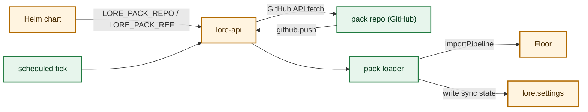
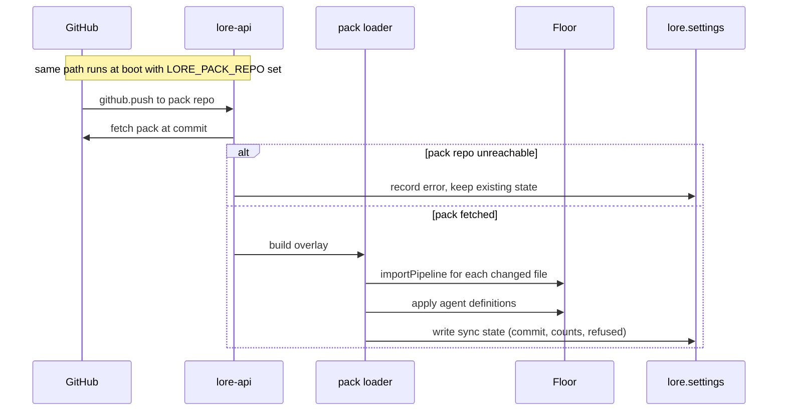
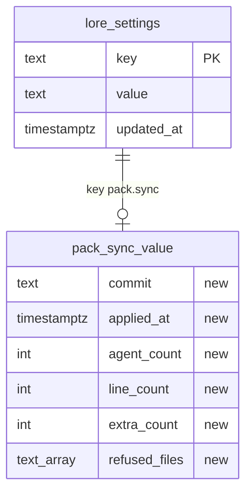
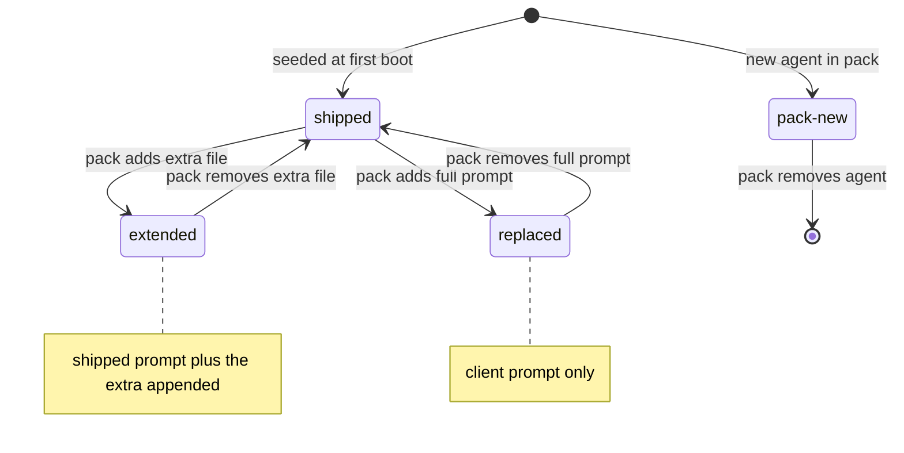

# Client packs: a client's own agents, prompts and assembly lines

| Feature | Client packs |
| ------- | ------------ |
| Branch  | main         |
| Status  | Draft        |
| Created | 2026-11-17   |
| Owner   | Bogdan       |

A client who installs Lore on their own Kubernetes cluster today cannot customise agent behaviour or add their own assembly lines without building a modified copy of the Lore image — or manually editing agents through the UI, which locks them out of improvements we ship to those agents in future releases. The pack solves this by letting clients configure a git repository of their own that Lore applies on top of what we ship.

## Problem Statement

A client who installs Lore on their own Kubernetes cluster today cannot customise agent behaviour or add their own assembly lines without building a modified copy of the Lore image — or manually editing agents through the UI, which locks them out of improvements we ship to those agents in future releases.

The pack solves this. A client configures the address of a git repository they own — their "pack" — in their Helm values. Lore reads that repository and applies it on top of what we ship: prompt extensions that add client-specific instructions while still receiving our future improvements; full prompt replacements where the client needs to diverge; new assembly lines the client defines from scratch; and removals that revert cleanly when a file is taken out of the pack.

Every change to the pack reaches the running install automatically — on a push to the pack repository, on a periodic catch-up, and whenever Lore restarts or is upgraded — without touching the cluster. A settings card shows the last commit applied and flags any files the sync refused. When no pack is configured, behaviour is exactly what it is today.

## Pack Configuration

- **FR-001**: A client configures the address of a git repository they own — their "pack" — in their Helm values.

## Pack Layout

## Agent Prompt Sources

- **FR-002**: Lore reads the pack repository and applies it on top of what we ship: prompt extensions that add client-specific instructions while still receiving our future improvements; full prompt replacements where the client needs to diverge; and removals that revert cleanly when a file is taken out of the pack.

## Automatic Sync

- **FR-003**: Every change to the pack reaches the running install automatically — on a push to the pack repository, on a periodic catch-up, and whenever Lore restarts or is upgraded — without touching the cluster.

## Apply Behavior

- **FR-004**: When no pack is configured, behaviour is exactly what it is today.

## Pack Pipelines

- **FR-005**: The pack supports new assembly lines the client defines from scratch.

## Pack Status Card

- **FR-006**: A settings card shows the last commit applied and flags any files the sync refused.

## Read-Only Enforcement

## Agent Author Identity

## Sketches

Pack feature: new and changed components

Pack sync: push-triggered and boot-time apply

New keys in lore.settings for pack config and sync state

Agent prompt source states: shipped, extended, replaced, pack-new

Pack status card on the Settings page
[Pack status card on the Settings page](sketches/m-ui-1.html)

## Success Criteria

## Open Questions
