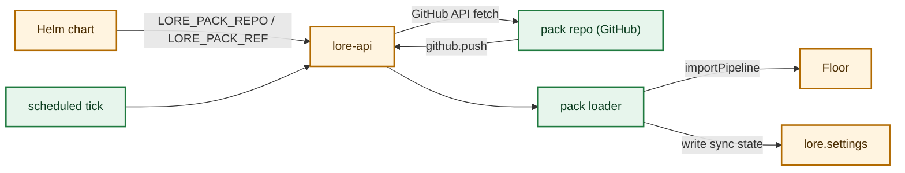
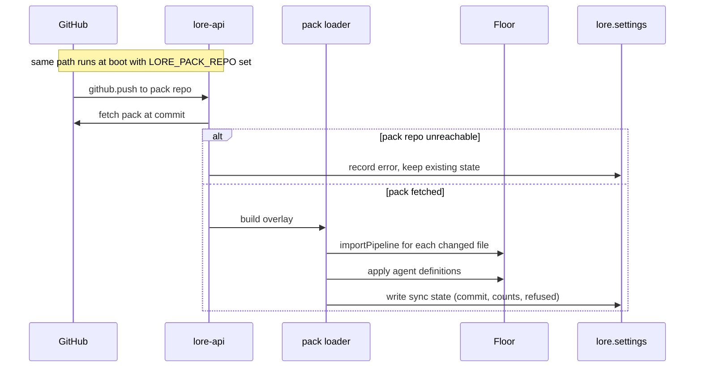
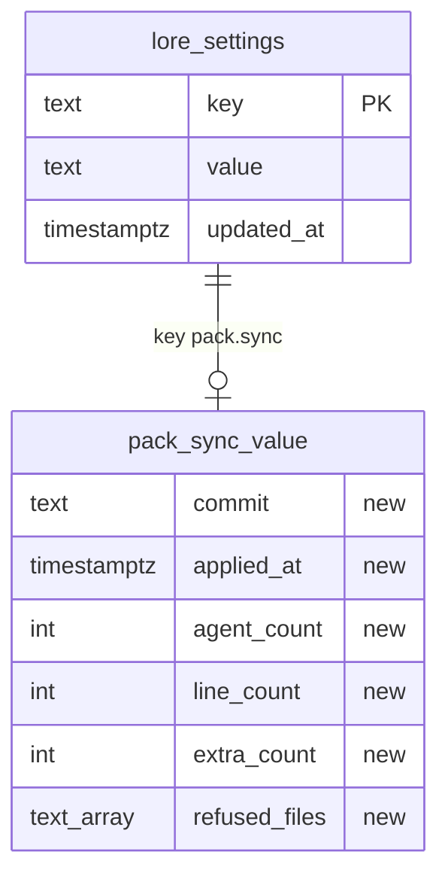
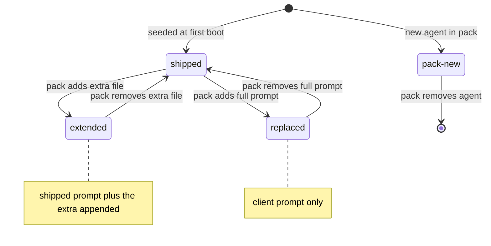

# Client packs: a client's own agents, prompts and assembly lines

| Feature | Client packs |
| ------- | ------------ |
| Branch  | main         |
| Status  | In Progress  |
| Created | 2026-11-17   |
| Owner   | Bogdan       |

A client who installs Lore on their own Kubernetes cluster today cannot customise agent behaviour or add their own assembly lines without building a modified copy of the Lore image — or manually editing agents through the UI, which locks them out of improvements we ship to those agents in future releases. The pack solves this by letting clients configure a git repository of their own that Lore applies on top of what we ship.

## Problem Statement

A client who installs Lore on their own Kubernetes cluster today cannot customise agent behaviour or add their own assembly lines without building a modified copy of the Lore image — or manually editing agents through the UI, which locks them out of improvements we ship to those agents in future releases. ([from plan](https://lore.gcp.re-cinq.com/repos/re-cinq/lore/plans/eccd0780-db5e-4dc4-be8a-5d7f059b1197#intent-p-1))

The pack solves this. A client configures the address of a git repository they own — their "pack" — in their Helm values. Lore reads that repository and applies it on top of what we ship: prompt extensions that add client-specific instructions while still receiving our future improvements; full prompt replacements where the client needs to diverge; new assembly lines the client defines from scratch; and removals that revert cleanly when a file is taken out of the pack. ([from plan](https://lore.gcp.re-cinq.com/repos/re-cinq/lore/plans/eccd0780-db5e-4dc4-be8a-5d7f059b1197#intent-p-2))

Every change to the pack reaches the running install automatically — on a push to the pack repository, on a periodic catch-up, and whenever Lore restarts or is upgraded — without touching the cluster. A settings card shows the last commit applied and flags any files the sync refused. When no pack is configured, behaviour is exactly what it is today. ([from plan](https://lore.gcp.re-cinq.com/repos/re-cinq/lore/plans/eccd0780-db5e-4dc4-be8a-5d7f059b1197#intent-p-3))

## Pack Configuration

- **FR-001**: A client configures the address of a git repository they own — their "pack" — via `LORE_PACK_REPO` and `LORE_PACK_REF` Helm values (`deploy/chart/charts/lore-api-helm/`, not on main); the repository may be on any git host Lore already integrates with, including GitHub Enterprise. ([from plan](https://lore.gcp.re-cinq.com/repos/re-cinq/lore/plans/eccd0780-db5e-4dc4-be8a-5d7f059b1197#scope-p-2)) ([validated by returns the repo and ref when both are set @e3a1585b](../../libs/shared/src/domain/pack-config.test.ts#L9)) ([validated by returns an undefined ref when LORE_PACK_REF is empty @9e8f5db4](../../libs/shared/src/domain/pack-config.test.ts#L15)) ([validated by reads the configured repo and ref and returns the commit with the pipeline file read at it @6458a580](../../apps/lore-api/src/work/pack/fetch-pack.test.ts#L28))

## Pack Layout

- **FR-007**: The pack organises its content one folder per pipeline, identified by the pipeline's name; each folder may hold a full pipeline definition, agent prompt files for the agents the pipeline uses, and extension files that append text to the shipped prompts. ([from plan](https://lore.gcp.re-cinq.com/repos/re-cinq/lore/plans/eccd0780-db5e-4dc4-be8a-5d7f059b1197#scope-p-3)) ([validated by parses a pipeline folder into a pipeline for the floor named after the folder @676127f3](../../apps/lore-api/src/work/pack/pack-loader.test.ts#L241)) ([validated by reads only pipeline.yaml and agents/*.md of a folder @c02d94b5](../../apps/lore-api/src/work/pack/fetch-pack.test.ts#L46))

- **FR-010**: Install documentation MUST ship with the feature: a pack layout reference describing the directory structure a pack repo must follow, and a custom stations service example. ([from plan](https://lore.gcp.re-cinq.com/repos/re-cinq/lore/plans/eccd0780-db5e-4dc4-be8a-5d7f059b1197#delivery-p-8))
- **FR-011**: A pack linter command MUST be provided at client handover; the client runs it in their pack repo's CI to catch invalid files before merge, using the same validation logic as Lore's own checks. ([from plan](https://lore.gcp.re-cinq.com/repos/re-cinq/lore/plans/eccd0780-db5e-4dc4-be8a-5d7f059b1197#delivery-p-9), [from plan](https://lore.gcp.re-cinq.com/repos/re-cinq/lore/plans/eccd0780-db5e-4dc4-be8a-5d7f059b1197#custom-risks-p-5)) ([validated by refuses nothing in a pack with a new pipeline folder and its new agent @f5326765](../../apps/lore-api/src/work/pack/pack-lint.test.ts#L67)) ([validated by refuses an extension of an agent nothing ships, naming its path @d1827f8c](../../apps/lore-api/src/work/pack/pack-lint.test.ts#L81)) ([validated by refuses a malformed agent file and a pipeline that is not a pipeline, keeping the good file @8e76905a](../../apps/lore-api/src/work/pack/pack-lint.test.ts#L93)) ([validated by ignores files of the pack repository that are not pack files @a8f28243](../../apps/lore-api/src/work/pack/pack-lint.test.ts#L111)) ([validated by fills an environment variable a pack agent names, since the install's environment is not the linter's @b2ff9233](../../apps/lore-api/src/work/pack/pack-lint.test.ts#L123)) ([validated by prints each refused file with its reason and exits 1 @00a209c5](../../apps/lore-api/src/work/pack/pack-lint.test.ts#L136)) ([validated by prints what the pack supplies and exits 0 when nothing is refused @fbfec4ba](../../apps/lore-api/src/work/pack/pack-lint.test.ts#L153)) ([validated by exits 2 and says how to call it when no directory is given @d753749c](../../apps/lore-api/src/work/pack/pack-lint.test.ts#L168))

## Agent Prompt Sources

- **FR-002**: Lore reads the pack repository and applies it on top of what we ship. The pack supports three kinds of agent file: a new agent defined entirely in the pack; a full replacement of a shipped agent's prompt; and an additive extension that appends to the shipped prompt while still receiving future improvements. Removals revert cleanly when a file is taken out of the pack. ([from plan](https://lore.gcp.re-cinq.com/repos/re-cinq/lore/plans/eccd0780-db5e-4dc4-be8a-5d7f059b1197#scope-p-4)) ([validated by appends an extension file to the shipped prompt of its agent @d3f646c5](../../apps/lore-api/src/work/pack/pack-loader.test.ts#L74)) ([validated by replaces a shipped agent wholesale with a full definition of the pack @68d7a226](../../apps/lore-api/src/work/pack/pack-loader.test.ts#L95)) ([validated by adds an agent nothing ships as pack-new @c8600856](../../apps/lore-api/src/work/pack/pack-loader.test.ts#L112)) ([validated by puts the shipped agent back when the pack no longer extends it @1dd7ab77](../../apps/lore-api/src/work/pack/apply-pack.test.ts#L93)) ([validated by writes the pack settings the way the floor stores them @ba9a0e24](../../apps/lore-api/src/work/pack/floor-agent-settings.test.ts#L39)) ([validated by reads the settings the floor holds as the snake_case the pack writes, without prices @de0ea89c](../../apps/lore-api/src/work/pack/floor-agent-settings.test.ts#L45))

- Full prompt replacement is the escape hatch for clients who must diverge entirely from a shipped agent; a client using full replacement will not receive future improvements to that agent's shipped prompt. The additive extension is the preferred path for client customisation. ([from plan](https://lore.gcp.re-cinq.com/repos/re-cinq/lore/plans/eccd0780-db5e-4dc4-be8a-5d7f059b1197#custom-risks-p-2)) ([validated by replaces a shipped agent wholesale with a full definition of the pack @68d7a226](../../apps/lore-api/src/work/pack/pack-loader.test.ts#L95))
- A prompt extension may contradict the shipped prompt; this is by design. The client owns the resulting behaviour and is responsible for testing it; Lore performs no automated consistency check between the extension and the shipped prompt. ([from plan](https://lore.gcp.re-cinq.com/repos/re-cinq/lore/plans/eccd0780-db5e-4dc4-be8a-5d7f059b1197#custom-risks-p-3))

## Automatic Sync

- **FR-003**: Every change to the pack reaches the running install automatically — at boot (`syncPackAtBoot` in `apps/lore-api/src/app/seed-floor.ts` syncs the pack through `applyPack` after `seedFloorPipelines` and the floor migrations and before the HTTP server starts listening, when `LORE_PACK_REPO` is set; `POST /api/pack/sync` (admin) and `GET /api/pack` serve the same sync and its state), on a push to the pack repository (a new `github.push` handler in `apps/stations/src/events/`, not on main, following the pattern in `apps/stations/src/events/floor-review-handlers.ts`), and on a scheduled catch-up tick (`cron.pack_sync.tick` added to `libs/shared/src/work/scheduler/`, not on main, with a sweep in `apps/stations/src/work/`) — without touching the cluster or performing a manual restart. ([from plan](https://lore.gcp.re-cinq.com/repos/re-cinq/lore/plans/eccd0780-db5e-4dc4-be8a-5d7f059b1197#scope-p-5), [from plan](https://lore.gcp.re-cinq.com/repos/re-cinq/lore/plans/eccd0780-db5e-4dc4-be8a-5d7f059b1197#delivery-p-2), [from plan](https://lore.gcp.re-cinq.com/repos/re-cinq/lore/plans/eccd0780-db5e-4dc4-be8a-5d7f059b1197#p_3e7d4628-b73f-42f2-8314-17d84dc82b9f)) ([validated by logs the commit and the agents it changed when the pack applies @33117312](../../apps/lore-api/src/app/seed-floor.test.ts#L116)) ([validated by logs the failure the pack recorded without throwing @7fe9d7d5](../../apps/lore-api/src/app/seed-floor.test.ts#L146)) ([validated by syncs when acme/lore-pack's main is pushed @da961c01](../../apps/stations/src/events/pack-push-handlers.test.ts#L32)) ([validated by asks lore-api to sync once and answers the line it read @824d5136](../../apps/stations/src/work/pack-sync-tick/pack-sync-tick.test.ts#L5)) ([validated by answers a dropped socket as the line, since the next tick asks again @47e30be3](../../apps/stations/src/work/pack-sync-tick/pack-sync-tick.test.ts#L23)) ([validated by schedules pack_sync every 15 minutes @c7ea2d4f](../../libs/shared/src/work/scheduler/cron-emitters.test.ts#L45)) ([validated by answers the applied commit and what changed @062381e3](../../apps/lore-api/src/transport/routes/pack/pack.test.ts#L119)) ([validated by posts the pack sync with the station token and no body @2d5f6178](../../apps/stations/src/work/utopia-backfill-tick/lore-api-backfill.test.ts#L144)) ([validated by names the commit and the agents a 200 applied @9d858062](../../apps/stations/src/work/pack-sync-tick/pack-sync-answer.test.ts#L5)) ([validated by reads a refusal as its status and body @64a852fc](../../apps/stations/src/work/pack-sync-tick/pack-sync-answer.test.ts#L20)) ([validated by reads a dropped socket as its message @b63e91ea](../../apps/stations/src/work/pack-sync-tick/pack-sync-answer.test.ts#L26)) ([validated by reads a 200 that is no sync result as unreadable @b38881d0](../../apps/stations/src/work/pack-sync-tick/pack-sync-answer.test.ts#L32)) ([validated by names the commit and the agents an applied pack changed @f9bcd3b6](../../libs/shared/src/domain/pack-sync-result-line.test.ts#L5)) ([validated by says none changed when the applied pack changed nothing @bb4dc596](../../libs/shared/src/domain/pack-sync-result-line.test.ts#L15)) ([validated by says no pack is configured when LORE_PACK_REPO is unset @bdf0ed7c](../../libs/shared/src/domain/pack-sync-result-line.test.ts#L21)) ([validated by names the error of a failed sync and that the floor keeps what it holds @aa3c2927](../../libs/shared/src/domain/pack-sync-result-line.test.ts#L27)) ([validated by logs a thrown sync and does not throw @db860324](../../apps/lore-api/src/app/seed-floor.test.ts#L158)) ([validated by does not sync the pack on a deployment with no floor configured @3ea9ddc9](../../apps/lore-api/src/app/seed-floor.test.ts#L170)) ([validated by answers the configured repo, its ref and the last sync @8b8faaf8](../../apps/lore-api/src/transport/routes/pack/pack.test.ts#L75)) ([validated by answers the result of the sync it ran @8d286d06](../../apps/lore-api/src/transport/routes/pack/pack.test.ts#L107)) ([validated by subscribes to github.push @3a5650df](../../apps/stations/src/events/pack-push-handlers.test.ts#L28)) ([validated by reads the repo name regardless of case @a861477a](../../apps/stations/src/events/pack-push-handlers.test.ts#L40)) ([validated by does not sync a push to another branch of the pack repo @4a506c86](../../apps/stations/src/events/pack-push-handlers.test.ts#L48)) ([validated by syncs a push to any branch when the pack names no ref, since the default branch is lore-api's to read @084df290](../../apps/stations/src/events/pack-push-handlers.test.ts#L64)) ([validated by answers 503 on the sync when there is no database @af85458c](../../apps/lore-api/src/transport/routes/pack/pack.test.ts#L138))

## Apply Behavior

- **FR-004**: When no pack is configured, behaviour is exactly what it is today. ([validated by returns null when LORE_PACK_REPO is unset @e76f8328](../../libs/shared/src/domain/pack-config.test.ts#L5)) ([validated by touches nothing when no pack is configured @c4c98868](../../apps/lore-api/src/work/pack/apply-pack.test.ts#L166)) ([validated by logs nothing on a deployment with no pack repo @2dbb8f2e](../../apps/lore-api/src/app/seed-floor.test.ts#L126)) ([validated by answers unconfigured when LORE_PACK_REPO is unset @a31205d4](../../apps/lore-api/src/transport/routes/pack/pack.test.ts#L126)) ([validated by answers configured false with no repo and no sync when LORE_PACK_REPO is unset @34616b55](../../apps/lore-api/src/transport/routes/pack/pack.test.ts#L87)) ([validated by syncs nothing on a deployment with no pack repo @bce788b7](../../apps/stations/src/events/pack-push-handlers.test.ts#L72))

- **FR-008**: Applies are idempotent: only files whose content has changed since the last apply produce new agent or pipeline versions. ([from plan](https://lore.gcp.re-cinq.com/repos/re-cinq/lore/plans/eccd0780-db5e-4dc4-be8a-5d7f059b1197#scope-p-6)) ([validated by puts nothing a second time when the pack has not changed @161719c7](../../apps/lore-api/src/work/pack/apply-pack.test.ts#L49))
- **FR-009**: Applies are removal-aware: removing an extension file from the pack reverts the affected agent to the shipped prompt; removing a client pipeline archives it on the Floor; runs already in progress finish on the version they started. ([from plan](https://lore.gcp.re-cinq.com/repos/re-cinq/lore/plans/eccd0780-db5e-4dc4-be8a-5d7f059b1197#scope-p-6)) ([validated by puts the shipped agent back when the pack no longer extends it @1dd7ab77](../../apps/lore-api/src/work/pack/apply-pack.test.ts#L93)) ([validated by archives a pipeline the pack no longer has @45952316](../../apps/lore-api/src/work/pack/apply-pack.test.ts#L137)) ([validated by leaves an agent only the pack defined as it is when the pack drops it @40e9ce0a](../../apps/lore-api/src/work/pack/apply-pack.test.ts#L118))

- **FR-012**: The work is sequenced so each incremental delivery leaves the system in a working state. ([from plan](https://lore.gcp.re-cinq.com/repos/re-cinq/lore/plans/eccd0780-db5e-4dc4-be8a-5d7f059b1197#delivery-p-1))
- **FR-013**: Pack boot (FR-001) and agent author identity migration MUST ship together: the prompt migration must accompany the first pack boot to avoid rewriting the author identity into prompts. ([from plan](https://lore.gcp.re-cinq.com/repos/re-cinq/lore/plans/eccd0780-db5e-4dc4-be8a-5d7f059b1197#delivery-p-10))
- **FR-015**: Pack pipeline support (FR-005) and pipeline removal MUST ship together: pipeline support without removal leaves orphaned definitions on the Floor. ([from plan](https://lore.gcp.re-cinq.com/repos/re-cinq/lore/plans/eccd0780-db5e-4dc4-be8a-5d7f059b1197#delivery-p-10))

- **FR-018**: If the pack repository is unreachable at sync time, Lore MUST keep what the Floor already holds and record the error in `pack.sync`; an unreachable pack is never treated as an empty pack, so a transient outage does not archive client pipelines. ([from plan](https://lore.gcp.re-cinq.com/repos/re-cinq/lore/plans/eccd0780-db5e-4dc4-be8a-5d7f059b1197#custom-risks-p-4)) ([validated by keeps the floor and the last good state and records the error when the pack is unreachable @43791d55](../../apps/lore-api/src/work/pack/apply-pack.test.ts#L183)) ([validated by records the error with nothing applied when the first sync cannot reach the pack @9a941f8e](../../apps/lore-api/src/work/pack/apply-pack.test.ts#L219)) ([validated by records the error and keeps the last good state when the floor refuses a put @4100796d](../../apps/lore-api/src/work/pack/apply-pack.test.ts#L242))

## Pack Pipelines

- **FR-005**: The pack supports new assembly lines the client defines from scratch; a folder in the pack defines a full pipeline alongside shipped files in `libs/assembly-lines/src/floor-pipelines/` (pack pipeline files live in the pack repo); a name collision between a pack folder and a shipped pipeline definition or another pack folder is refused. ([from plan](https://lore.gcp.re-cinq.com/repos/re-cinq/lore/plans/eccd0780-db5e-4dc4-be8a-5d7f059b1197#delivery-p-4)) ([validated by parses a pipeline folder into a pipeline for the floor named after the folder @676127f3](../../apps/lore-api/src/work/pack/pack-loader.test.ts#L241)) ([validated by refuses a pipeline folder named like a shipped pipeline @c002a1b5](../../apps/lore-api/src/work/pack/pack-loader.test.ts#L256)) ([validated by refuses a pipeline whose line is not named after its folder @3125fc76](../../apps/lore-api/src/work/pack/pack-loader.test.ts#L276)) ([validated by refuses a pipeline naming an agent that neither Lore ships nor the pack defines @ac95ab04](../../apps/lore-api/src/work/pack/pack-loader.test.ts#L290)) ([validated by accepts a pipeline naming a shipped agent the pack does not touch, and keeps its agents out of the pipeline @3dc2f8c5](../../apps/lore-api/src/work/pack/pack-loader.test.ts#L308)) ([validated by imports a pack pipeline and lists it in the sync state @dae5e1eb](../../apps/lore-api/src/work/pack/apply-pack.test.ts#L68))

- **FR-013**: Pipelines that need client-owned logic use a separately deployed stations service built on the published station contract; Lore itself runs no client code. ([from plan](https://lore.gcp.re-cinq.com/repos/re-cinq/lore/plans/eccd0780-db5e-4dc4-be8a-5d7f059b1197#scope-p-12))
- **FR-014**: The pack documentation covers pack layout and includes an example of a custom stations service for pipelines that need client-owned code. ([from plan](https://lore.gcp.re-cinq.com/repos/re-cinq/lore/plans/eccd0780-db5e-4dc4-be8a-5d7f059b1197#scope-p-10))

- **FR-007**: A client pipeline folder removed from the pack is archived on the Floor via an archive operation on `libs/shared/src/outbound/floor/floor-client.ts`; it is not deleted. ([from plan](https://lore.gcp.re-cinq.com/repos/re-cinq/lore/plans/eccd0780-db5e-4dc4-be8a-5d7f059b1197#delivery-p-5)) ([validated by archives a pipeline the pack no longer has @45952316](../../apps/lore-api/src/work/pack/apply-pack.test.ts#L137))

## Pack Status Card

- **FR-006**: A read-only Pack status card on the Settings page (`apps/web-ui/src/app/settings/`, not on main) shows the connected repository and branch, the last commit applied and when, counts of what the pack supplies (agents, pipelines, extensions), and any files the last sync refused; a "Sync now" action on the card triggers an immediate pack apply (access control subject to Q1); the data is served from the `pack.sync` key in `lore.settings` (`apps/lore-api/src/transport/routes/repos/org-settings.ts#L93`, not on main). ([from plan](https://lore.gcp.re-cinq.com/repos/re-cinq/lore/plans/eccd0780-db5e-4dc4-be8a-5d7f059b1197#scope-p-8), [from plan](https://lore.gcp.re-cinq.com/repos/re-cinq/lore/plans/eccd0780-db5e-4dc4-be8a-5d7f059b1197#delivery-p-6)) ([validated by counts the agents the pack sets, its pipelines and its extensions @16d5017b](../../apps/lore-api/src/work/pack/pack-loader.test.ts#L322)) ([validated by shows acme/lore-pack on branch main with the applied commit 9a7b72d, its time, and 3 agents, 1 line, 2 extras @885c1d4f](../../apps/web-ui/src/app/settings/PackStatusCard.test.tsx#L29)) ([validated by names the default branch when the pack has no ref @960dc74f](../../apps/web-ui/src/app/settings/PackStatusCard.test.tsx#L44)) ([validated by shows Failed and the error, keeping the last applied commit 9a7b72d, when the last sync failed @9f70468c](../../apps/web-ui/src/app/settings/PackStatusCard.test.tsx#L52)) ([validated by lists each refused file with its reason @49bb9a34](../../apps/web-ui/src/app/settings/PackStatusCard.test.tsx#L72)) ([validated by shows no refused list when nothing was refused @c45333ec](../../apps/web-ui/src/app/settings/PackStatusCard.test.tsx#L87)) ([validated by submits the form to the sync action when Sync now is clicked @a047674f](../../apps/web-ui/src/app/settings/PackStatusCard.test.tsx#L93)) ([validated by shows Not synced yet with a Sync now button before the first sync of acme/lore-pack @2ab049a0](../../apps/web-ui/src/app/settings/PackStatusCard.test.tsx#L102)) ([validated by shows the Pack card between Platform and Approval gates when acme/lore-pack is configured @c967d9e0](../../apps/web-ui/src/app/settings/SettingsView.test.tsx#L74)) ([validated by shows no Pack card while no pack is configured @779e0dac](../../apps/web-ui/src/app/settings/SettingsView.test.tsx#L100)) ([validated by answers null when no pack is configured @bfeb16ed](../../apps/web-ui/src/lib/api/pack.test.ts#L5)) ([validated by answers an empty sync of acme/lore-pack on main when configured and never synced @d44430a1](../../apps/web-ui/src/lib/api/pack.test.ts#L16)) ([validated by answers the recorded sync once one has run @e4200aa5](../../apps/web-ui/src/lib/api/pack.test.ts#L40))

## Read-Only Enforcement

- **FR-010**: Agents the pack supplies become read-only org defaults: write routes for agent definitions (`apps/lore-api/src/transport/routes/agent-definitions/`, not on main) refuse requests that target pack-managed agents. ([from plan](https://lore.gcp.re-cinq.com/repos/re-cinq/lore/plans/eccd0780-db5e-4dc4-be8a-5d7f059b1197#scope-p-7)) ([validated by answers 409 pack_managed and leaves the floor's fix-ci on claude-sonnet-4-6 when the pack manages fix-ci @8e8a4b19](../../apps/lore-api/src/transport/routes/agent-definitions/org-update.test.ts#L91)) ([validated by answers 200 for fix-ci when the pack manages only acme-triage @76a4a86e](../../apps/lore-api/src/transport/routes/agent-definitions/org-update.test.ts#L110)) ([validated by flags acme-triage pack_managed and loop-tdd not when the pack manages acme-triage @158c0ef3](../../apps/lore-api/src/transport/routes/agent-definitions/org-list.test.ts#L96))
- **FR-011**: The Edit action does not appear for pack-managed agents in the per-repository Agents tab (`apps/web-ui/src/app/repos/[owner]/[repo]/agents/`) or the global agents catalog (`apps/web-ui/src/app/agents/`), both not on main; per-repository agent variants remain editable. ([from plan](https://lore.gcp.re-cinq.com/repos/re-cinq/lore/plans/eccd0780-db5e-4dc4-be8a-5d7f059b1197#scope-p-7)) ([validated by links Edit to /agents/edit/loop-tdd and not for the pack-managed acme-triage @32cf7415](../../apps/web-ui/src/app/agents/AgentCards.test.tsx#L21)) ([validated by says Managed by pack on the acme-triage card @e3bcd055](../../apps/web-ui/src/app/agents/AgentCards.test.tsx#L39)) ([validated by links Edit for the project variant of triage and not for the pack-managed org default of general, keeping the row's cell count @49aab841](../../apps/web-ui/src/app/repos/[owner]/[repo]/agents/AgentList.test.tsx#L66)) ([validated by hides Edit for a pack-managed row in the editable org catalog too @07a18791](../../apps/web-ui/src/app/repos/[owner]/[repo]/agents/AgentList.test.tsx#L89))

- **FR-008**: Pack-managed agent org defaults are read-only: write routes in `apps/lore-api/src/transport/routes/agent-definitions/` MUST refuse updates to pack-managed agents. ([from plan](https://lore.gcp.re-cinq.com/repos/re-cinq/lore/plans/eccd0780-db5e-4dc4-be8a-5d7f059b1197#delivery-p-6)) ([validated by flags the org default of general and triage pack_managed and the project variant of triage not, when the pack manages both @1cfe5727](../../apps/lore-api/src/transport/routes/agent-definitions/agents-route.test.ts#L131))
- **FR-016**: The Edit link MUST NOT appear for pack-managed agents in `apps/web-ui/src/app/repos/[owner]/[repo]/agents/` or the global agents catalog at `apps/web-ui/src/app/agents/`. ([from plan](https://lore.gcp.re-cinq.com/repos/re-cinq/lore/plans/eccd0780-db5e-4dc4-be8a-5d7f059b1197#delivery-p-6)) ([validated by links Edit to /agents/edit/loop-tdd and not for the pack-managed acme-triage @32cf7415](../../apps/web-ui/src/app/agents/AgentCards.test.tsx#L21)) ([validated by says Managed by pack on the acme-triage card @e3bcd055](../../apps/web-ui/src/app/agents/AgentCards.test.tsx#L39)) ([validated by links Edit for the project variant of triage and not for the pack-managed org default of general, keeping the row's cell count @49aab841](../../apps/web-ui/src/app/repos/[owner]/[repo]/agents/AgentList.test.tsx#L66)) ([validated by hides Edit for a pack-managed row in the editable org catalog too @07a18791](../../apps/web-ui/src/app/repos/[owner]/[repo]/agents/AgentList.test.tsx#L89))

## Agent Author Identity

- **FR-012**: The commit author identity used by agents, currently embedded in `libs/shared/src/agent-defaults/*.md` as `${LORE_*}` placeholders, moves to Helm values (`LORE_COMMIT_AUTHOR_NAME`, `LORE_COMMIT_AUTHOR_EMAIL` or similar, not on main) so each client can configure their own. ([from plan](https://lore.gcp.re-cinq.com/repos/re-cinq/lore/plans/eccd0780-db5e-4dc4-be8a-5d7f059b1197#scope-p-9)) ([validated by gives every delivering recipe the commit author through config.env and no git identity line in its prompt @dfa8dea8](../../libs/shared/src/outbound/project/agents/agent-defaults-content.test.ts#L45))

- **FR-009**: The commit author name and email used by Lore's agents MUST move from the shipped prompt files in `libs/shared/src/agent-defaults/*.md` to Helm values (`LORE_COMMIT_AUTHOR_NAME` and `LORE_COMMIT_AUTHOR_EMAIL`, not on main). ([from plan](https://lore.gcp.re-cinq.com/repos/re-cinq/lore/plans/eccd0780-db5e-4dc4-be8a-5d7f059b1197#delivery-p-7)) ([validated by gives every delivering recipe the commit author through config.env and no git identity line in its prompt @dfa8dea8](../../libs/shared/src/outbound/project/agents/agent-defaults-content.test.ts#L45))
- **FR-017**: A migration in `deploy/chart/charts/ui-helm/migrations/` MUST handle clusters that already hold prompts with the author identity embedded. ([from plan](https://lore.gcp.re-cinq.com/repos/re-cinq/lore/plans/eccd0780-db5e-4dc4-be8a-5d7f059b1197#delivery-p-7)) ([validated by writes the shipped prompt and env of the six agents that commit, and nothing else @1183fc89](../../apps/lore-api/src/work/floor/floor-migrations.test.ts#L280)) ([validated by names floor/0001 to floor/0013, whose every prompt, timeout, skills list and env comes from a shipped agent file @79678006](../../apps/lore-api/src/work/floor/floor-migrations.test.ts#L110))

## Sketches

Pack feature: new and changed components

Pack sync: push-triggered and boot-time apply

New keys in lore.settings for pack config and sync state

Agent prompt source states: shipped, extended, replaced, pack-new

Pack status card on the Settings page
[Pack status card on the Settings page](sketches/m-ui-1.html)

## Success Criteria

- A client can customise agent behaviour and add assembly lines without building a modified copy of the Lore image. ([from plan](https://lore.gcp.re-cinq.com/repos/re-cinq/lore/plans/eccd0780-db5e-4dc4-be8a-5d7f059b1197#k-pack-image-unchanged)) ([validated by appends the extension to the shipped prompt of the reviewer @1f1de434](../../apps/lore-api/src/app/pack.acceptance.test.ts#L83)) ([validated by imports the new acme-flow pipeline and its new agent @d718e08a](../../apps/lore-api/src/app/pack.acceptance.test.ts#L89))
- A pack reaches the running install and is applied without touching the cluster. ([from plan](https://lore.gcp.re-cinq.com/repos/re-cinq/lore/plans/eccd0780-db5e-4dc4-be8a-5d7f059b1197#k-push-to-applied)) ([validated by records the head commit and what the pack supplies in pack.sync @4e5ac9ab](../../apps/lore-api/src/app/pack.acceptance.test.ts#L98))
- Pack prompt extensions append to shipped prompts without replacing them, so the client's install continues to receive Lore's future improvements to those agents. ([from plan](https://lore.gcp.re-cinq.com/repos/re-cinq/lore/plans/eccd0780-db5e-4dc4-be8a-5d7f059b1197#k-upgrade-extra-recompose)) ([validated by appends an extension file to the shipped prompt of its agent @d3f646c5](../../apps/lore-api/src/work/pack/pack-loader.test.ts#L74))
- A malformed or invalid file in the pack is refused and recorded without halting the install. ([from plan](https://lore.gcp.re-cinq.com/repos/re-cinq/lore/plans/eccd0780-db5e-4dc4-be8a-5d7f059b1197#k-bad-file-no-halt)) ([validated by refuses a malformed agent file and still applies the others @0bb787ac](../../apps/lore-api/src/work/pack/pack-loader.test.ts#L154)) ([validated by refuses an extension of an agent nothing ships and records why @926c8da6](../../apps/lore-api/src/work/pack/pack-loader.test.ts#L134)) ([validated by refuses a full agent definition without %s @d6cf8221](../../apps/lore-api/src/work/pack/pack-loader.test.ts#L179)) ([validated by refuses the extension when the same pack also has the full file of that agent @7999b1fa](../../apps/lore-api/src/work/pack/pack-loader.test.ts#L190)) ([validated by refuses an agent a second folder defines again @e30fcf4c](../../apps/lore-api/src/work/pack/pack-loader.test.ts#L211)) ([validated by refuses an agent file naming an environment variable that is not set @e35a59d6](../../apps/lore-api/src/work/pack/pack-loader.test.ts#L227)) ([validated by refuses a pipeline file that is not a pipeline @06bfb5c6](../../apps/lore-api/src/work/pack/pack-loader.test.ts#L300)) ([validated by keeps a pipeline whose file the pack now holds malformed, and records the refused file @bf4dbae9](../../apps/lore-api/src/work/pack/apply-pack.test.ts#L265)) ([validated by keeps an agent set by the last sync whose file the pack now holds malformed @841d3cdc](../../apps/lore-api/src/work/pack/apply-pack.test.ts#L293))

- **SC-001**: Acceptance is confirmed by an internal cluster test with a scratch pack repo containing a prompt extension on a shipped pipeline and one new pipeline folder: (1) the extended agent's prompt body, readable via the agent-definitions route in `apps/lore-api/src/transport/routes/agent-definitions/`, includes the extension text appended after the shipped prompt; (2) the new pipeline name appears in Floor's pipeline list (verifiable via `importPipeline` in `libs/shared/src/outbound/floor/floor-client.ts`); (3) the `commit` field in the `pack.sync` JSON value stored in `lore.settings` (FR-C-004) equals the scratch pack's HEAD commit SHA and `applied_at` is non-null; and (4) the write route for that agent's org default at `apps/lore-api/src/transport/routes/agent-definitions/` returns HTTP 4xx (FR-010). ([from plan](https://lore.gcp.re-cinq.com/repos/re-cinq/lore/plans/eccd0780-db5e-4dc4-be8a-5d7f059b1197#delivery-p-11)) ([validated by appends the extension to the shipped prompt of the reviewer @1f1de434](../../apps/lore-api/src/app/pack.acceptance.test.ts#L83)) ([validated by imports the new acme-flow pipeline and its new agent @d718e08a](../../apps/lore-api/src/app/pack.acceptance.test.ts#L89)) ([validated by records the head commit and what the pack supplies in pack.sync @4e5ac9ab](../../apps/lore-api/src/app/pack.acceptance.test.ts#L98)) ([validated by answers 409 pack_managed to a write of the pack's reviewer through the real route, leaving the floor's prompt @d52a7040](../../apps/lore-api/src/app/pack.acceptance.test.ts#L114))

## Open Questions

- **Q1 — Sync now access**: Is the "Sync now" action restricted to org admins, or available to all users who can reach the settings page? ([from plan](https://lore.gcp.re-cinq.com/repos/re-cinq/lore/plans/eccd0780-db5e-4dc4-be8a-5d7f059b1197#q-sync-now-access))
- **Q2 — Pack repository host**: Is the pack repository assumed to always be on GitHub, or must the design support other hosts (GitLab, self-hosted) from the start? ([from plan](https://lore.gcp.re-cinq.com/repos/re-cinq/lore/plans/eccd0780-db5e-4dc4-be8a-5d7f059b1197#q-github-only))

- **OQ-1**: When re-applying a pack agent that already has per-repository variants, should the apply merge (preserve per-repo variants) or replace (overwrite the whole agent)? ([from plan](https://lore.gcp.re-cinq.com/repos/re-cinq/lore/plans/eccd0780-db5e-4dc4-be8a-5d7f059b1197#q-reapply-merge-or-replace))

- Who is the technical owner for this feature? Bogdan to name. ([from plan](https://lore.gcp.re-cinq.com/repos/re-cinq/lore/plans/eccd0780-db5e-4dc4-be8a-5d7f059b1197#q-technical-owner))

- **Q-001**: How often should the scheduled catch-up tick (`cron.pack_sync.tick`) run? ([from plan](https://lore.gcp.re-cinq.com/repos/re-cinq/lore/plans/eccd0780-db5e-4dc4-be8a-5d7f059b1197#q-tick-frequency))

## Out of Scope

- New integrations are added to Lore itself through separate plans, not via packs. ([from plan](https://lore.gcp.re-cinq.com/repos/re-cinq/lore/plans/eccd0780-db5e-4dc4-be8a-5d7f059b1197#scope-p-13))
- A pack can extend a shipped pipeline's agent prompts but cannot replace the pipeline's shape; Lore's own behaviour depends on those shapes. ([from plan](https://lore.gcp.re-cinq.com/repos/re-cinq/lore/plans/eccd0780-db5e-4dc4-be8a-5d7f059b1197#scope-p-14))
- One pack per installation is supported; multiple packs or one pack per team are not. ([from plan](https://lore.gcp.re-cinq.com/repos/re-cinq/lore/plans/eccd0780-db5e-4dc4-be8a-5d7f059b1197#scope-p-15))

## Constraints

- **FR-C-001**: The overlay — the step that combines what Lore ships with what the pack supplies to produce the effective set of agents and pipelines — MUST be computed without touching the Floor; the pack loader MUST follow the `SeedDeps` port pattern (`files()`, `heldAgentDefinitions()`, `importPipeline()`) declared in `apps/lore-api/src/work/floor/seed-floor-pipelines.ts`, so overlay logic can be exercised in tests without a running cluster. ([from plan](https://lore.gcp.re-cinq.com/repos/re-cinq/lore/plans/eccd0780-db5e-4dc4-be8a-5d7f059b1197#constraints-p-1)) ([validated by appends an extension file to the shipped prompt of its agent @d3f646c5](../../apps/lore-api/src/work/pack/pack-loader.test.ts#L74)) ([validated by refuses a pipeline folder named like a shipped pipeline @c002a1b5](../../apps/lore-api/src/work/pack/pack-loader.test.ts#L256))
- **FR-C-002**: Agents the pack does not name MUST keep today's behavior: seeded at first boot and updated through Lore's standard migration path. ([from plan](https://lore.gcp.re-cinq.com/repos/re-cinq/lore/plans/eccd0780-db5e-4dc4-be8a-5d7f059b1197#constraints-p-2)) ([validated by leaves a shipped agent the pack does not name out of the overlay @8ec20b07](../../apps/lore-api/src/work/pack/pack-loader.test.ts#L332))
- **FR-C-003**: Environment values MUST NOT be substituted into prompts; they MUST be substituted only into agent settings via `withEnvironment` (`apps/lore-api/src/work/floor/seed-floor-pipelines.ts`), which fills `${LORE_*}` env vars in settings and never in prompt bodies. The commit author identity MUST be removed from the shipped prompt files (`libs/shared/src/agent-defaults/*.md`) and moved to per-install Helm configuration; this feature adds `LORE_COMMIT_AUTHOR_NAME` and `LORE_COMMIT_AUTHOR_EMAIL` to the Helm chart (`deploy/chart/charts/lore-api/`) for this purpose, with a migration for clusters that already hold the existing prompts. ([from plan](https://lore.gcp.re-cinq.com/repos/re-cinq/lore/plans/eccd0780-db5e-4dc4-be8a-5d7f059b1197#constraints-p-3)) ([validated by gives agent loop-dod the commit author through config.env and no git identity line in its prompt @584c7b7b](../../apps/lore-api/src/work/floor/seed-floor-pipelines.test.ts#L309)) ([validated by adds the shipped env with the environment filled in to the org default's env and keeps the env it already has @425a1c40](../../apps/lore-api/src/work/floor/floor-migrations.test.ts#L398)) ([validated by throws naming the variable when the environment lacks one the shipped env names @ff749dda](../../apps/lore-api/src/work/floor/floor-migrations.test.ts#L425)) ([validated by throws for a shipped file with no env @3e4b024e](../../apps/lore-api/src/work/floor/floor-migrations.test.ts#L438)) ([validated by fills the environment into the settings of a pack agent and never into its prompt @481664f0](../../apps/lore-api/src/work/pack/pack-loader.test.ts#L121))
- **FR-C-004**: Sync state (last commit applied, refused files, counts) MUST be stored once in `lore.settings` under the `pack.sync` key — shaped by the model in `libs/shared/src/domain/models/` and returned by the `SELECT key, value, updated_at FROM lore.settings` query in `apps/lore-api/src/transport/routes/repos/org-settings.ts` — and shared across all Lore replicas, so the settings page is consistent regardless of which replica serves the request. ([from plan](https://lore.gcp.re-cinq.com/repos/re-cinq/lore/plans/eccd0780-db5e-4dc4-be8a-5d7f059b1197#constraints-p-4)) ([validated by returns the pack.sync state parsed beside the settings rows @917b69fb](../../apps/lore-api/src/transport/routes/repos/org-settings.test.ts#L68)) ([validated by accepts the state a successful sync stores @cbf42258](../../libs/shared/src/domain/models/pack-sync-state.test.ts#L25)) ([validated by accepts the state of a first sync that failed, with no commit applied yet @1c81ba05](../../libs/shared/src/domain/models/pack-sync-state.test.ts#L29)) ([validated by refuses a state with a negative agent count @3065f833](../../libs/shared/src/domain/models/pack-sync-state.test.ts#L48)) ([validated by returns null when the setting is unset @0fabc872](../../libs/shared/src/outbound/project/settings/pack-sync-store.test.ts#L21)) ([validated by returns the state stored as JSON text @9714d603](../../libs/shared/src/outbound/project/settings/pack-sync-store.test.ts#L25)) ([validated by throws naming pack.sync when the stored text is not a state @b9bd7eb7](../../libs/shared/src/outbound/project/settings/pack-sync-store.test.ts#L29)) ([validated by puts the extended agent on the floor and records the commit it applied @557f30fc](../../apps/lore-api/src/work/pack/apply-pack.test.ts#L13)) ([validated by answers 503 when there is no database @a7d9a08f](../../apps/lore-api/src/transport/routes/pack/pack.test.ts#L94))
- **FR-C-005**: Lore MUST read the pack through the same git host integration it already uses (`apps/lore-api/src/outbound/github-client.ts`; single-host config via `libs/shared/src/domain/github-host.ts` and `GITHUB_HOST`). That integration must be installed on the pack repository before Lore can sync it; the same host support Lore already offers — including GitHub Enterprise — applies to the pack. ([from plan](https://lore.gcp.re-cinq.com/repos/re-cinq/lore/plans/eccd0780-db5e-4dc4-be8a-5d7f059b1197#constraints-p-5)) ([validated by reads the configured repo and ref and returns the commit with the pipeline file read at it @6458a580](../../apps/lore-api/src/work/pack/fetch-pack.test.ts#L28))
- **FR-C-006**: An apply triggered by an incoming webhook MUST be idempotent and safe to run more than once; when multiple Lore replicas receive the same push event simultaneously, the apply MUST acquire a `DbLeaseBackend` lease (`libs/shared/src/outbound/project/leases/lease-backends.ts`) so only one replica proceeds. ([from plan](https://lore.gcp.re-cinq.com/repos/re-cinq/lore/plans/eccd0780-db5e-4dc4-be8a-5d7f059b1197#constraints-p-6)) ([validated by applies the pack under the pack-sync lease and releases it @4130a328](../../apps/lore-api/src/work/pack/sync-pack.test.ts#L12)) ([validated by skips when another replica holds the lease and leaves its lease alone @fae0e725](../../apps/lore-api/src/work/pack/sync-pack.test.ts#L36)) ([validated by releases the lease when the apply itself throws @a7489156](../../apps/lore-api/src/work/pack/sync-pack.test.ts#L57)) ([validated by syncs when acme/lore-pack's main is pushed @da961c01](../../apps/stations/src/events/pack-push-handlers.test.ts#L32)) ([validated by does not sync a push to another repo @3d1e1bba](../../apps/stations/src/events/pack-push-handlers.test.ts#L56)) ([validated by logs the lease holder's skip as another replica applying @02748bf9](../../apps/lore-api/src/app/seed-floor.test.ts#L134)) ([validated by says another replica holds the lease when lore-api skipped the sync @c98c2526](../../apps/stations/src/work/pack-sync-tick/pack-sync-answer.test.ts#L14)) ([validated by says another replica holds the lease when the sync was skipped @9471d297](../../libs/shared/src/domain/pack-sync-result-line.test.ts#L35))
- **FR-C-007**: When applying a pack agent that already has per-repository variants, the apply MUST preserve those variants: the org default for that agent is updated from the pack, but existing per-repository customisations are merged rather than replaced, using `withVariant` in `libs/shared/src/outbound/project/agents/agent-defs-floor.ts` and the resolution chain in `libs/shared/src/outbound/project/agents/agent-defs-port.ts`. ([from plan](https://lore.gcp.re-cinq.com/repos/re-cinq/lore/plans/eccd0780-db5e-4dc4-be8a-5d7f059b1197#p_864ae530-b83a-44c0-a252-e335f77a2803), [from plan](https://lore.gcp.re-cinq.com/repos/re-cinq/lore/plans/eccd0780-db5e-4dc4-be8a-5d7f059b1197#custom-risks-p-1)) ([validated by writes the pack settings as the org default and keeps the repository variants the floor holds @814c0c89](../../apps/lore-api/src/work/pack/floor-agent-settings.test.ts#L53)) ([validated by writes a body with no variants for an agent the floor does not hold @22fc6fa8](../../apps/lore-api/src/work/pack/floor-agent-settings.test.ts#L65))

## Ownership

- The Lore platform team owns changes to Lore itself. The technical owner for this feature is to be named by Bogdan. ([from plan](https://lore.gcp.re-cinq.com/repos/re-cinq/lore/plans/eccd0780-db5e-4dc4-be8a-5d7f059b1197#ownership-p-1))
- re-cinq writes and maintains the first client's pack. The client takes it over after handover is complete. ([from plan](https://lore.gcp.re-cinq.com/repos/re-cinq/lore/plans/eccd0780-db5e-4dc4-be8a-5d7f059b1197#ownership-p-2))
