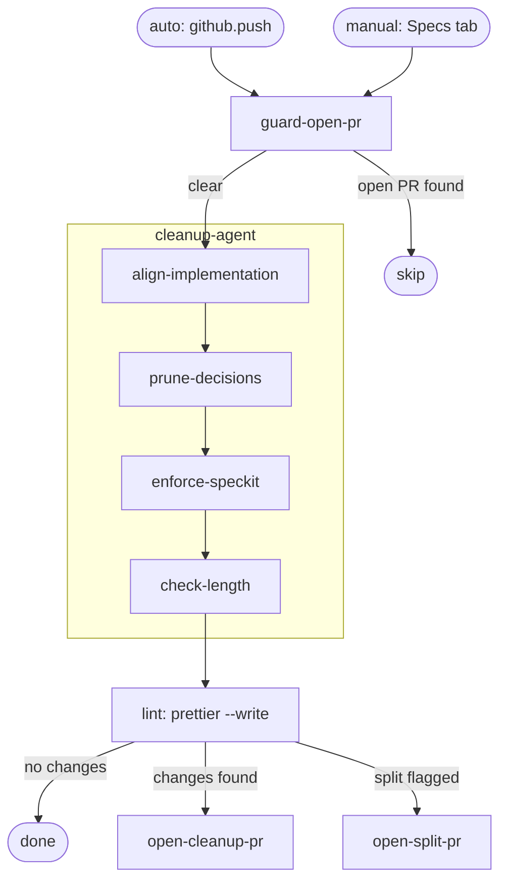

# Feature Specification: Spec maintenance loop

| Feature | spec-maintenance |
| Status | Draft |
| Created | 2026-11-16 |
| Owner | Lore Platform Team |

This specification describes a new automated maintenance loop that ensures the specification corpus remains clean, current, and correctly structured over time.

## Problem Statement

Today the weekly Spec upkeep loop corrects drift between individual spec statements and their test results. It does not address how a spec is structured: whether it has accumulated historical wording from past amendments, grown past the point where a reader can hold it in mind, drifted from the SpecKit format the planning line uses when it writes new specs, or been placed outside a feature directory where the tooling expects it. These structural gaps widen every time a feature evolves, and today they close only when someone notices and acts. ([from plan](https://lore.gcp.re-cinq.com/repos/re-cinq/lore/plans/143a6e64-0fa1-4146-9d90-99247bbac92e#intent-p-10))

## Loop behaviour

The Spec maintenance loop automatically closes structural gaps without manual overhead. Whenever a spec file changes, or a person requests it from the spec screen, the loop runs a cleanup pass on that file. The pass enforces the structural rules the team already applies by hand, touching only specification files and never guessing at intent. ([from plan](https://lore.gcp.re-cinq.com/repos/re-cinq/lore/plans/143a6e64-0fa1-4146-9d90-99247bbac92e#intent-p-1)) ([from plan](https://lore.gcp.re-cinq.com/repos/re-cinq/lore/plans/143a6e64-0fa1-4146-9d90-99247bbac92e#intent-p-11))

### Loops tab

### Specs tab trigger

### Automatic trigger

## Assembly line passes

### guard-open-pr

- The guard-open-pr station MUST check for an open pull request in the repository that touches the target spec file; if one exists, the station logs "skipped — open PR #N" and halts the run, the board row shows "skipped" rather than a failure, and the station does not close or modify the conflicting PR and does not block on PRs that touch only other spec files. ([from plan](https://lore.gcp.re-cinq.com/repos/re-cinq/lore/plans/143a6e64-0fa1-4146-9d90-99247bbac92e#custom-assembly-line-stations-p-4))
- The guard-open-pr station is the only station that can stop the run before any change is written. ([from plan](https://lore.gcp.re-cinq.com/repos/re-cinq/lore/plans/143a6e64-0fa1-4146-9d90-99247bbac92e#custom-assembly-line-stations-p-5))

### align-implementation

The loop ensures the spec always matches the present implementation if linked to a test. ([from plan](https://lore.gcp.re-cinq.com/repos/re-cinq/lore/plans/143a6e64-0fa1-4146-9d90-99247bbac92e#intent-p-3)) Where a test exists that covers behaviour the spec describes but has not yet cited that test, the loop discovers the association and adds the missing test link to the matching spec statement. ([from plan](https://lore.gcp.re-cinq.com/repos/re-cinq/lore/plans/143a6e64-0fa1-4146-9d90-99247bbac92e#p_ba2e1147-2c13-49e2-bec6-a2ff3b9bde7f))

- The align-implementation station MUST read every spec statement that carries a test-link parenthetical pointing to a test file or test identifier; for each linked statement it checks the current test result against the statement's wording and rewrites the statement to reflect the current assertion if the wording no longer matches what the test asserts. ([from plan](https://lore.gcp.re-cinq.com/repos/re-cinq/lore/plans/143a6e64-0fa1-4146-9d90-99247bbac92e#custom-assembly-line-stations-p-7))
- The align-implementation station MUST NOT touch statements that have no test link; it does not run, modify, or reference test files and reads only the test identifier to look up the recorded result. ([from plan](https://lore.gcp.re-cinq.com/repos/re-cinq/lore/plans/143a6e64-0fa1-4146-9d90-99247bbac92e#custom-assembly-line-stations-p-8))

### prune-decisions

The loop drops historical amendment markers from spec statements and rewrites them in the present tense, keeping only the last decision in the present tense when multiple superseded decisions exist. ([from plan](https://lore.gcp.re-cinq.com/repos/re-cinq/lore/plans/143a6e64-0fa1-4146-9d90-99247bbac92e#intent-p-4)) The repository's commit history already holds the full timeline of every change; the spec file needs to show only what is true now. ([from plan](https://lore.gcp.re-cinq.com/repos/re-cinq/lore/plans/143a6e64-0fa1-4146-9d90-99247bbac92e#p_d54a519a-856a-4a32-8d84-8b1f8ffeaf05))

- The prune-decisions station MUST scan the spec for statements that carry inline amendment markers — text such as "(added 2026-10-01, amended 2026-10-23)" or similar date-annotated notes — and for each marked statement rewrite it in the present tense and strip the history annotation entirely. ([from plan](https://lore.gcp.re-cinq.com/repos/re-cinq/lore/plans/143a6e64-0fa1-4146-9d90-99247bbac92e#custom-assembly-line-stations-p-10))
- The prune-decisions station MUST NOT choose between two conflicting statements or remove content that has no amendment marker. ([from plan](https://lore.gcp.re-cinq.com/repos/re-cinq/lore/plans/143a6e64-0fa1-4146-9d90-99247bbac92e#custom-assembly-line-stations-p-11))

### enforce-speckit

The loop ensures specs match the SpecKit format ([from plan](https://lore.gcp.re-cinq.com/repos/re-cinq/lore/plans/143a6e64-0fa1-4146-9d90-99247bbac92e#intent-p-6)), and that only spec files in folders are managed; everything else is managed by Lore. ([from plan](https://lore.gcp.re-cinq.com/repos/re-cinq/lore/plans/143a6e64-0fa1-4146-9d90-99247bbac92e#intent-p-7))

- The enforce-speckit station MUST read the full spec file and the SpecKit template expected by the planning line; it validates section order, required metadata rows (Owner, Status, Linked plan), and statement format; any section that is out of order, any missing required row, or any statement that does not match the expected format is rewritten to conform to the template. ([from plan](https://lore.gcp.re-cinq.com/repos/re-cinq/lore/plans/143a6e64-0fa1-4146-9d90-99247bbac92e#custom-assembly-line-stations-p-13))
- The enforce-speckit station MUST change only structure and placement; it does not alter the meaning of any statement. ([from plan](https://lore.gcp.re-cinq.com/repos/re-cinq/lore/plans/143a6e64-0fa1-4146-9d90-99247bbac92e#custom-assembly-line-stations-p-14))

### check-length

When a spec is too long (over approximately 500 lines of code), the loop splits it. It extracts sub-features to create a new spec in a new folder, linking the extracted paragraphs back to the tests. ([from plan](https://lore.gcp.re-cinq.com/repos/re-cinq/lore/plans/143a6e64-0fa1-4146-9d90-99247bbac92e#intent-p-5))

- The check-length station MUST count lines in the spec file after the three preceding passes have completed; if the count is under the threshold (approximately 500 lines), the station passes the file to lint unchanged. ([from plan](https://lore.gcp.re-cinq.com/repos/re-cinq/lore/plans/143a6e64-0fa1-4146-9d90-99247bbac92e#custom-assembly-line-stations-p-16))
- If the count exceeds the threshold, the check-length station MUST identify coherent sub-features in the spec, draft each as a new spec.md in a sibling feature directory, rewrite the relevant sections of the original spec to link to the new files, and set a split flag visible to the assembly line; a split MUST always open a separate pull request addressed to the team named in the spec's Owner row; the station MUST NOT commit a split directly to the default branch and MUST NOT auto-merge its own split pull requests. ([from plan](https://lore.gcp.re-cinq.com/repos/re-cinq/lore/plans/143a6e64-0fa1-4146-9d90-99247bbac92e#custom-assembly-line-stations-p-17))

### lint and PR outcome

- The assembly line opens at most two pull requests per run: one cleanup PR if any of the four cleanup passes changed the file, and one split PR if check-length flagged a split; both are opened only after lint confirms that the file is valid. ([from plan](https://lore.gcp.re-cinq.com/repos/re-cinq/lore/plans/143a6e64-0fa1-4146-9d90-99247bbac92e#custom-assembly-line-stations-p-2))
- The lint station MUST run prettier --write on every spec file written during this run; if no bytes changed after formatting, the run ends with a "no changes" result and no pull request is opened; if bytes changed, the assembly line opens a cleanup PR against the default branch; if the split flag is set, it opens a second, separate split PR. ([from plan](https://lore.gcp.re-cinq.com/repos/re-cinq/lore/plans/143a6e64-0fa1-4146-9d90-99247bbac92e#custom-assembly-line-stations-p-19))
- Lint is format-only; it does not validate content logic and does not run against code or test files. ([from plan](https://lore.gcp.re-cinq.com/repos/re-cinq/lore/plans/143a6e64-0fa1-4146-9d90-99247bbac92e#custom-assembly-line-stations-p-20))

- The spec-maintenance assembly line MUST run stations sequentially whenever a spec file in a feature directory lands on the default branch or when someone clicks Run maintenance from the Specs tab; each station receives the spec file path as its only input and writes changes back to the same file; a station that makes no changes passes the file to the next one unchanged; a station that halts the run (guard-open-pr) prevents every downstream station from running. ([from plan](https://lore.gcp.re-cinq.com/repos/re-cinq/lore/plans/143a6e64-0fa1-4146-9d90-99247bbac92e#custom-assembly-line-stations-p-1))

## Constraints

- The cleanup agent (`apps/stations/src/spec-maintenance/cleanup-agent/`, added by this feature) changes specification files only; its prompt at `libs/shared/src/agent-defaults/cleanup-agent.md` (added by this feature) references `.lore/spec-standard.md` (the SpecKit format, existing on main) to enforce these constraints. ([from plan](https://lore.gcp.re-cinq.com/repos/re-cinq/lore/plans/143a6e64-0fa1-4146-9d90-99247bbac92e#constraints-p-1)) ([from plan](https://lore.gcp.re-cinq.com/repos/re-cinq/lore/plans/143a6e64-0fa1-4146-9d90-99247bbac92e#scope-p-6))
- The cleanup agent lints specification files after changing them, following the same constraint the existing upkeep agent follows. ([from plan](https://lore.gcp.re-cinq.com/repos/re-cinq/lore/plans/143a6e64-0fa1-4146-9d90-99247bbac92e#scope-p-6)) ([from plan](https://lore.gcp.re-cinq.com/repos/re-cinq/lore/plans/143a6e64-0fa1-4146-9d90-99247bbac92e#constraints-p-1))
- The cleanup agent must not run tests, type-checks, or builds (consistent with the existing upkeep agent policy). ([from plan](https://lore.gcp.re-cinq.com/repos/re-cinq/lore/plans/143a6e64-0fa1-4146-9d90-99247bbac92e#scope-p-12)) ([from plan](https://lore.gcp.re-cinq.com/repos/re-cinq/lore/plans/143a6e64-0fa1-4146-9d90-99247bbac92e#constraints-p-1))
- A spec split creates a new feature directory and rewrites the original spec to reference the new one; it opens a separate pull request for human review rather than committing directly to the default branch. The team named in the spec's Owner row is responsible for reviewing and merging it; the loop does not auto-merge its own split pull requests. The `open-pr` station (`apps/stations/src/spec-maintenance/open-pr/`, added by this feature) opens both the cleanup PR and, when the split flag is set, the separate split PR. ([from plan](https://lore.gcp.re-cinq.com/repos/re-cinq/lore/plans/143a6e64-0fa1-4146-9d90-99247bbac92e#constraints-p-2))
- The Spec maintenance loop is off by default for every repository and must be switched on explicitly in the Loops tab, consistent with how every other loop in the product is gated; the settings key `spec_maintenance.enabled` in `libs/shared/src/domain/loops/loop-enabled.ts` (added by this feature) is false by omission. ([from plan](https://lore.gcp.re-cinq.com/repos/re-cinq/lore/plans/143a6e64-0fa1-4146-9d90-99247bbac92e#constraints-p-4))
- A cleanup run for a spec must not start if there is an open pull request that will touch that specific spec; the `guard-open-pr` station (`apps/stations/src/spec-maintenance/guard-open-pr/`, added by this feature) halts the run when such a PR is found. ([from plan](https://lore.gcp.re-cinq.com/repos/re-cinq/lore/plans/143a6e64-0fa1-4146-9d90-99247bbac92e#constraints-p-3))

- The on-demand "Run maintenance" button on the Specs tab (added to `apps/web-ui/src/app/repos/[owner]/[repo]/specs/SpecListView.tsx` by this feature) MUST ship in the same release as the automatic push trigger; no new screen is required because the Specs tab already lists a repository's spec files today. ([from plan](https://lore.gcp.re-cinq.com/repos/re-cinq/lore/plans/143a6e64-0fa1-4146-9d90-99247bbac92e#delivery-p-2))
- All five cleanup operations — test-link discovery, implementation alignment, decision pruning, length-based splitting, and SpecKit format compliance — MUST ship together in a single release; the loop being off by default for every repository (settings key `spec_maintenance.enabled`, false by omission in `libs/shared/src/domain/loops/loop-enabled.ts`) is the safeguard that prevents any cleanup run from starting until a team deliberately switches it on from the Loops tab, and the split operation's additional structural protection — always opening a pull request via the `open-pr` station (`apps/stations/src/spec-maintenance/open-pr/`, added by this feature) for human review rather than committing directly to the default branch — allows the split to ship alongside the other four operations in the same release. ([from plan](https://lore.gcp.re-cinq.com/repos/re-cinq/lore/plans/143a6e64-0fa1-4146-9d90-99247bbac92e#delivery-p-3))

## SC-001 — 100% of spec files pass all structural checks without manual intervention

- Every spec that fails a structural check is a gap the team must close by hand; the loop MUST reach and hold 100% of spec files passing all structural checks without manual intervention. ([from plan](https://lore.gcp.re-cinq.com/repos/re-cinq/lore/plans/143a6e64-0fa1-4146-9d90-99247bbac92e#k-spec-maint-1))

## SC-002 — 0% of spec files in feature directories exceed ~500 lines

- An oversized spec signals that sub-features have not been extracted; this metric MUST confirm the split operation is running and landing by reaching and remaining at 0% of spec files in feature directories exceeding approximately 500 lines. ([from plan](https://lore.gcp.re-cinq.com/repos/re-cinq/lore/plans/143a6e64-0fa1-4146-9d90-99247bbac92e#k-spec-maint-2))

## SC-003 — Median time from spec change landing to cleanup PR under 4 hours

- A cleanup that arrives the same day as the change costs the reviewer little context; a cleanup that arrives a week later arrives cold and is more likely to be postponed. The median time from a spec file change landing to a cleanup PR opening MUST remain under 4 hours. ([from plan](https://lore.gcp.re-cinq.com/repos/re-cinq/lore/plans/143a6e64-0fa1-4146-9d90-99247bbac92e#k-spec-maint-3))

## Sketches

Flow: Spec maintenance assembly line: guard, four cleanup passes, lint, and open PR.

Architecture: New spec-maintenance pipeline alongside spec-upkeep on the external Floor.

UI: Specs tab (/repos/:repo/specs) with per-spec Run maintenance button.
[m-ui-1.html](./sketches/m-ui-1.html)

UI: Loops tab with Spec maintenance switch (off by default) beside existing loops.
[m-ui-2.html](./sketches/m-ui-2.html)

Architecture: What each pipeline station does — inputs, outputs, and boundaries (runs in order shown).
[m-architecture-2.html](./sketches/m-architecture-2.html)

## Scope

**In scope**

- A new Spec maintenance loop, visible in the repository's Loops tab with its own on/off switch and board rows (Current, Parked, Recently addressed); a new `maintenance` key is appended to the `LOOP_KINDS` tuple in `libs/shared/src/domain/loops/loop-kinds.ts` and a matching `maintenance: specMaintenanceSwitchedOn` entry to `SWITCHED_ON_BY_KEY` in `libs/shared/src/domain/loops/loop-enabled.ts`, reading `spec_maintenance.enabled`, off by omission; the Loops tab at `apps/web-ui/src/app/repos/[owner]/[repo]/loops/` iterates `LOOP_KINDS` dynamically and needs no per-loop view fork. ([from plan](https://lore.gcp.re-cinq.com/repos/re-cinq/lore/plans/143a6e64-0fa1-4146-9d90-99247bbac92e#scope-p-2))
- An assembly line (`libs/assembly-lines/src/floor-pipelines/spec-maintenance.yaml`, added by this feature) that picks up a changed spec file from a feature directory and applies five cleanup operations in sequence: test-link discovery, implementation alignment, decision pruning, length-based splitting, and SpecKit format compliance. ([from plan](https://lore.gcp.re-cinq.com/repos/re-cinq/lore/plans/143a6e64-0fa1-4146-9d90-99247bbac92e#scope-p-3)) ([from plan](https://lore.gcp.re-cinq.com/repos/re-cinq/lore/plans/143a6e64-0fa1-4146-9d90-99247bbac92e#intent-p-2))
- Automatic triggering: when a spec file matching `specs/*/spec.md` inside a feature directory lands on the default branch, the loop starts one cleanup run for that file; the trigger is wired in `apps/stations/src/work/spec-maintenance-tick/` (added by this feature) via the `github.push` event handler in `apps/stations/src/events/`. ([from plan](https://lore.gcp.re-cinq.com/repos/re-cinq/lore/plans/143a6e64-0fa1-4146-9d90-99247bbac92e#scope-p-4))
- On-demand triggering from the existing repository Specs tab (`apps/web-ui/src/app/repos/[owner]/[repo]/specs/page.tsx`, rendered by `SpecListView.tsx`): a "Run maintenance" button per spec card (sketch m-ui-1) starts a cleanup run for any spec; no new screen is needed. ([from plan](https://lore.gcp.re-cinq.com/repos/re-cinq/lore/plans/143a6e64-0fa1-4146-9d90-99247bbac92e#scope-p-5))

**Out of scope**

- Plan and task artefacts inside a feature directory; the loop does not rewrite those files. ([from plan](https://lore.gcp.re-cinq.com/repos/re-cinq/lore/plans/143a6e64-0fa1-4146-9d90-99247bbac92e#scope-p-8))
- ADR files; they follow a different convention and are not spec files in the SpecKit sense. ([from plan](https://lore.gcp.re-cinq.com/repos/re-cinq/lore/plans/143a6e64-0fa1-4146-9d90-99247bbac92e#scope-p-9))
- Standalone spec files not inside a feature directory; those are managed directly by Lore and fall outside the SpecKit convention this loop enforces. ([from plan](https://lore.gcp.re-cinq.com/repos/re-cinq/lore/plans/143a6e64-0fa1-4146-9d90-99247bbac92e#scope-p-10))
- Any change to code, test files, build output, or configuration. ([from plan](https://lore.gcp.re-cinq.com/repos/re-cinq/lore/plans/143a6e64-0fa1-4146-9d90-99247bbac92e#scope-p-11))
- The existing weekly Spec upkeep loop; it continues to run independently and is not replaced or merged by this change. ([from plan](https://lore.gcp.re-cinq.com/repos/re-cinq/lore/plans/143a6e64-0fa1-4146-9d90-99247bbac92e#scope-p-13))

## Open Questions

> **Question** (q-loop-label-conflict): The answer to the loop label question gives 'Spec upkeep' as the display name with the description 'Keep this repository's specifications true.' — but that is the name and description of the existing weekly Spec upkeep loop that already appears in the Loops tab. Two loops cannot share a name. Was the intent to rename this new loop to something that follows the same naming style, or to confirm a different name entirely? ([from plan](https://lore.gcp.re-cinq.com/repos/re-cinq/lore/plans/143a6e64-0fa1-4146-9d90-99247bbac92e#q-loop-label-conflict))

> **Question** (q-spec-screen): What is the "spec screen" that serves as the on-demand trigger point? Is it an existing UI surface in the product that shows a spec's content, or does a new screen need to be built? ([from plan](https://lore.gcp.re-cinq.com/repos/re-cinq/lore/plans/143a6e64-0fa1-4146-9d90-99247bbac92e#q-spec-screen))

> **Question** (q-loop-name): What is the loop's name in the Loops tab? The plan uses "Spec maintenance" as a working name. Is that the intended name, or is a different name preferred? ([from plan](https://lore.gcp.re-cinq.com/repos/re-cinq/lore/plans/143a6e64-0fa1-4146-9d90-99247bbac92e#q-loop-name))

> **Question** (q-loop-label): What should the loop's display name and one-line description be in the Loops tab switch? For example, Spec upkeep shows as 'Spec upkeep' with the description 'Keep this repository's specifications true.' The plan uses 'Spec maintenance' as a working name but that has not been confirmed. ([from plan](https://lore.gcp.re-cinq.com/repos/re-cinq/lore/plans/143a6e64-0fa1-4146-9d90-99247bbac92e#q-loop-label))

> **Question** (q-split-gating): Should the spec split operation be gated behind a separate opt-in flag per repository in the first release, or should it ship enabled alongside the other three cleanup operations? ([from plan](https://lore.gcp.re-cinq.com/repos/re-cinq/lore/plans/143a6e64-0fa1-4146-9d90-99247bbac92e#q-split-gating))

> **Question** (q-superseded-decisions): What counts as a "superseded decision" for the pruning operation? Does the loop look for spec statements that carry historical amendment notes (like "*(amended 2026-10-xx)*" markers) and rewrite them in the present tense, dropping the history? Or is there a different kind of obsolete content in mind? ([from plan](https://lore.gcp.re-cinq.com/repos/re-cinq/lore/plans/143a6e64-0fa1-4146-9d90-99247bbac92e#q-superseded-decisions))

## Ownership

- The Lore Platform Team owns the loop, its assembly line, and the cleanup agent definition. That team is responsible for the automatic trigger wiring, the board rows in the Loops tab, and the on-demand trigger surface. ([from plan](https://lore.gcp.re-cinq.com/repos/re-cinq/lore/plans/143a6e64-0fa1-4146-9d90-99247bbac92e#ownership-p-1))
- The team named in a spec's Owner row is responsible for reviewing and merging any pull request the loop opens for that spec, including split pull requests that create new feature directories. ([from plan](https://lore.gcp.re-cinq.com/repos/re-cinq/lore/plans/143a6e64-0fa1-4146-9d90-99247bbac92e#ownership-p-2))
