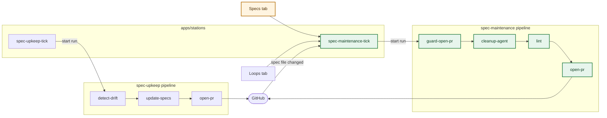

# Feature Specification: Spec maintenance loop

| Feature | spec-maintenance |
| Status | Draft |
| Created | 2026-11-16 |
| Owner | Lore Platform Team |

This specification describes a new automated maintenance loop that ensures the specification corpus remains clean, current, and correctly structured over time.

## Problem Statement

Today the weekly Spec upkeep loop corrects drift between individual spec statements and their test results. It does not address how a spec is structured: whether it has accumulated historical wording from past amendments, grown past the point where a reader can hold it in mind, drifted from the SpecKit format the planning line uses when it writes new specs, or been placed outside a feature directory where the tooling expects it. These structural gaps widen every time a feature evolves, and today they close only when someone notices and acts.

## Loop behaviour

The Spec maintenance loop automatically closes structural gaps without manual overhead. Whenever a spec file changes, or a person requests it from the spec screen, the loop runs a cleanup pass on that file. The pass enforces the structural rules the team already applies by hand, touching only specification files and never guessing at intent.

### Loops tab

### Specs tab trigger

### Automatic trigger

## Assembly line passes

### guard-open-pr

### align-implementation

The loop ensures the spec always matches the present implementation if linked to a test. Where a test exists that covers behaviour the spec describes but has not yet cited that test, the loop discovers the association and adds the missing test link to the matching spec statement.

### prune-decisions

The loop drops historical amendment markers from spec statements and rewrites them in the present tense. The repository's commit history already holds the full timeline of every change; the spec file needs to show only what is true now.

### enforce-speckit

The loop ensures specs match the SpecKit format, and that only spec files in folders are managed.

### check-length

When a spec is too long (over approximately 500 lines of code), the loop splits it. It extracts sub-features to create a new spec in a new folder, linking the extracted paragraphs back to the tests.

### lint and PR outcome

## Constraints

- The cleanup agent changes specification files only.
- The cleanup agent lints specification files after changing them.
- The cleanup agent must not run tests, type-checks, or builds.
- A spec split always opens a separate pull request reviewed by the team named in the spec's Owner row.
- The Spec maintenance loop is off by default for every repository.
- The loop prevents two cleanup runs from acting on the same spec file in parallel.

## SC-001 — 100% of spec files pass all structural checks without manual intervention

## SC-002 — 0% of spec files in feature directories exceed ~500 lines

## SC-003 — Median time from spec change landing to cleanup PR under 4 hours

## Sketches

Flow: Spec maintenance assembly line: guard, four cleanup passes, lint, and open PR.

Architecture: New spec-maintenance pipeline alongside spec-upkeep on the external Floor.

UI: Specs tab (/repos/:repo/specs) with per-spec Run maintenance button.
[m-ui-1.html](./sketches/m-ui-1.html)

UI: Loops tab with Spec maintenance switch (off by default) beside existing loops.
[m-ui-2.html](./sketches/m-ui-2.html)

Architecture: What each pipeline station does — inputs, outputs, and boundaries (runs in order shown).
[m-architecture-2.html](./sketches/m-architecture-2.html)

## Open Questions

> **Question** (q-loop-label-conflict): The answer to the loop label question gives 'Spec upkeep' as the display name with the description 'Keep this repository's specifications true.' — but that is the name and description of the existing weekly Spec upkeep loop that already appears in the Loops tab. Two loops cannot share a name. Was the intent to rename this new loop to something that follows the same naming style, or to confirm a different name entirely?
